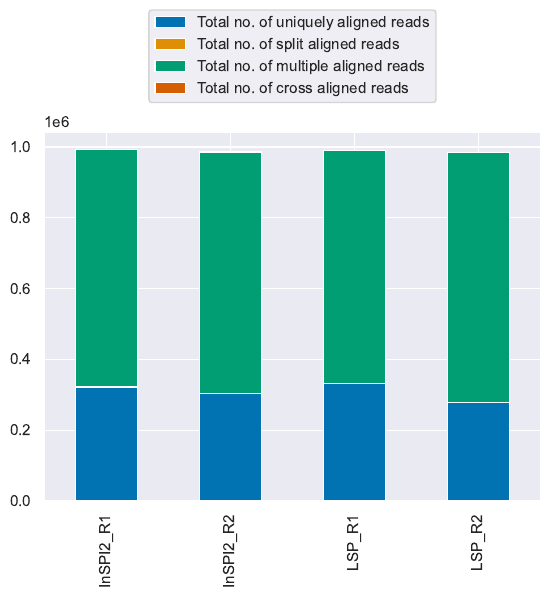
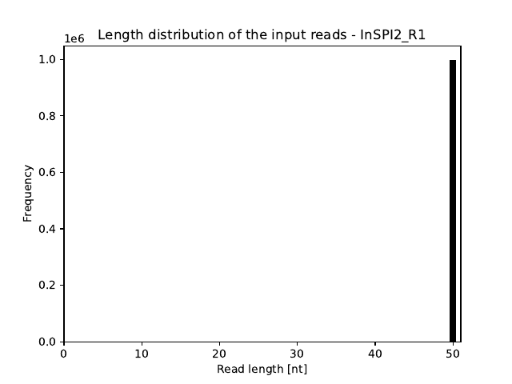
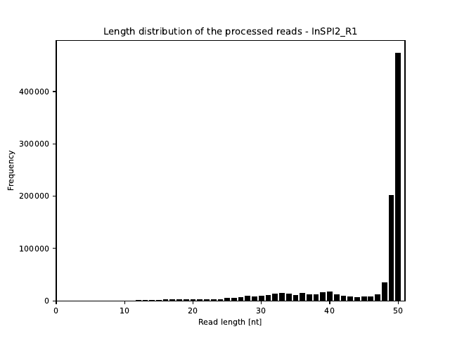
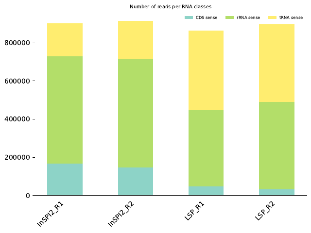
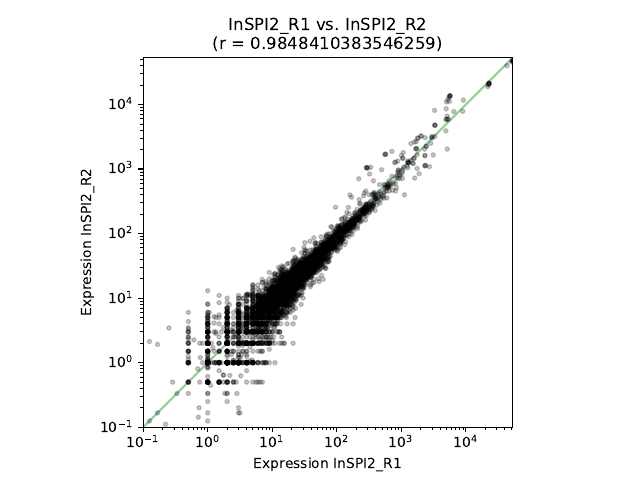
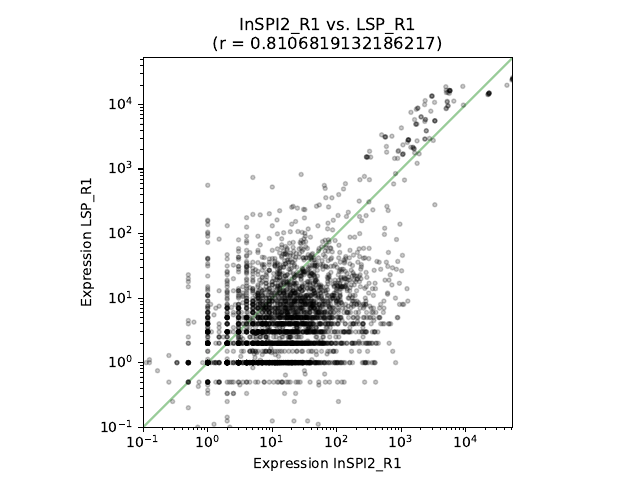
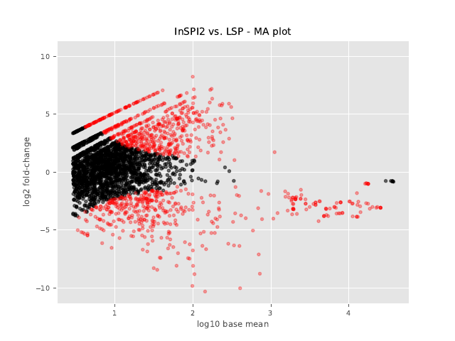
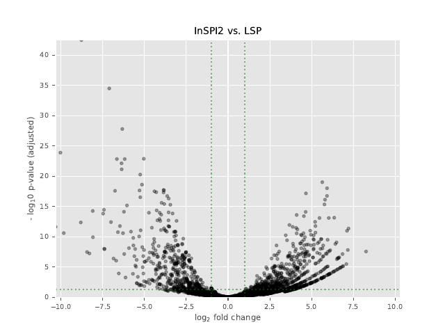

# Results: Example 01, *Salmonella* in two growth conditions

This page explains what the analysis found and how to read every plot. You do
not need to run anything to follow it.

All numbers come from one complete run of
[`example_01_analysis.sh`](../example_01_analysis.sh) with READemption 2.0.4.
If you run the script yourself you should get the same numbers.

## The short version

- **What was compared:** *Salmonella* Typhimurium grown in two media, with two
  samples (replicates) of each.
  - `InSPI2`: a medium that imitates the inside of a host cell and switches
    on the SPI-2 virulence genes
  - `LSP`: rich medium, late stationary phase
- **Data quality:** about 99 % of the reads could be placed on the genome,
  and the two replicates of each condition agree well.
- **Main result:** 1,055 of the 3,013 genes that could be tested changed at
  least two-fold between the conditions: 600 were more active in InSPI2 and
  455 were more active in LSP.
- **Does it make sense?** Yes. The SPI-2 genes (`ssaV`, `ssaJ`, `ssaR`,
  `ssaI`) are among the genes most strongly switched on in InSPI2, which is
  exactly what that medium is designed to do.

## Words used on this page

| Word | Meaning |
|---|---|
| Read | One short piece of RNA sequence produced by the sequencing machine. Here each read is 50 letters long. |
| Aligning | Finding the place on the genome a read came from. |
| Replicate | A repeat of the same experiment. Two replicates that agree show that a result is not an accident. |
| Expression | How active a gene is. More reads from a gene means higher expression. |
| Fold change | How many times more (or less) active a gene is in one condition than in the other. |
| log2 fold change | The fold change on a doubling scale: +1 means twice as much, +2 four times, +3 eight times; -1 means half as much. 0 means no change. |
| p-value | The chance of seeing a difference this large if there were really no difference. Small is convincing. |
| padj | The p-value corrected for the fact that thousands of genes are tested at once. This is the one to use. Below 0.05 is the usual cut-off. |

## 1. Were the reads placed on the genome?

**How to read it.** One bar per sample. The height is the number of reads
that were aligned (the scale `1e6` means millions, so 1.0 is one million).
The colours split each bar:

- **blue**: reads that fit exactly one place on the genome ("uniquely aligned")
- **green**: reads that fit several places equally well ("multiple aligned")

**What it shows.** Every sample started with 1,000,000 reads and nearly all
of them were aligned.

| Sample | Reads | Aligned | Aligned to one place only |
|---|---|---|---|
| InSPI2_R1 | 1,000,000 | 99.3 % | 32.5 % |
| InSPI2_R2 | 1,000,000 | 98.6 % | 31.0 % |
| LSP_R1 | 1,000,000 | 99.0 % | 33.5 % |
| LSP_R2 | 1,000,000 | 98.5 % | 28.3 % |

Only about a third of the reads fit a single place. That is normal for this
data set and not a problem: the rest comes mostly from ribosomal RNA and
transfer RNA genes, which exist in several identical copies on the genome,
so a read from one copy fits all of them (see section 3).

## 2. How long are the reads?

Before cleaning:

After cleaning:

**How to read it.** The horizontal axis is the read length in letters
(nucleotides, "nt"). The height of a bar is the number of reads with that
length. The plots show sample InSPI2_R1; the PDF files have one page per
sample.

**What it shows.** Before cleaning, every read is exactly 50 letters long.
During cleaning, READemption cuts off runs of A's at the end of reads that
were added in the laboratory. Most reads stay at 49 or 50 letters, a smaller
group becomes shorter, and reads that end up shorter than 12 letters are
thrown away (between 2,600 and 5,800 reads per sample, less than 1 %).

## 3. What kind of RNA do the reads come from?

**How to read it.** One bar per sample, split by the kind of gene the reads
landed on:

- **turquoise (CDS)**: protein-coding genes, the ones we are interested in
- **green (rRNA)**: ribosomal RNA
- **yellow (tRNA)**: transfer RNA

**What it shows.**

| Sample | Protein-coding genes | rRNA | tRNA |
|---|---|---|---|
| InSPI2_R1 | 168,378 | 562,357 | 171,496 |
| InSPI2_R2 | 148,546 | 569,059 | 196,651 |
| LSP_R1 | 47,562 | 400,101 | 415,396 |
| LSP_R2 | 33,792 | 455,534 | 406,722 |

Most reads come from rRNA and tRNA, which are the most abundant RNAs in any
cell. Only 3 to 17 % of the reads come from protein-coding genes, and the
LSP samples have fewer of them than the InSPI2 samples. This means the
protein-coding genes are measured from a fairly small number of reads,
especially in LSP. Genes with very few reads cannot be judged, which is why
only 3,013 of the 4,979 annotated genes could be tested in section 5.

## 4. Do the replicates agree?

Two replicates of the same condition (InSPI2_R1 against InSPI2_R2):

Two different conditions (InSPI2_R1 against LSP_R1):

**How to read it.** Every dot is one gene. Its position to the right is the
number of reads in the first sample, its height is the number of reads in
the second sample. Both axes are logarithmic: each step (10, 100, 1,000) is
ten times more. A dot on the green diagonal line has the same activity in
both samples. The number `r` in the title is the correlation: 1 means
identical, 0 means unrelated.

**What it shows.**

- The two InSPI2 replicates form a narrow band along the diagonal
  (r = 0.985). The two LSP replicates agree nearly as well (r = 0.946). The
  experiment is reproducible.
- Comparing InSPI2 with LSP gives a wide cloud (r between 0.71 and 0.87).
  Many genes are far from the diagonal, so many genes really differ between
  the two conditions.

The vertical and horizontal stripes at the lower left are genes with only
1, 2 or 3 reads: counts are whole numbers, so they line up.

The file `expression_scatter_plots.pdf` has all twelve sample pairs.

## 5. Which genes changed?

For every gene, the program DESeq2 compares the read counts of the two
conditions and reports how big the change is (log2 fold change) and how
sure we can be about it (padj).

In this comparison, called "InSPI2 vs. LSP", a **positive** log2 fold change
means the gene is **more active in InSPI2**, and a **negative** one means it
is **more active in LSP**.

### MA plot

**How to read it.** Every dot is one gene.

- Left to right: how active the gene is on average over all samples
  (logarithmic: 1 means about 10 reads, 2 about 100, 3 about 1,000).
- Up and down: the log2 fold change. Dots above 0 are more active in InSPI2,
  dots below 0 are more active in LSP. The further from 0, the bigger the
  change.
- **Red** dots are genes with a statistically significant change
  (padj below 0.05). **Black** dots are not significant.

**What it shows.** A large share of the genes is red, both above and below
zero, so the two conditions differ strongly in both directions. Changes of
5 on this scale are common, which is a 32-fold difference. The diagonal
lines of dots on the left are genes that have reads in only one condition.
The dots on the far right are the most abundant genes, mainly rRNA and
tRNA.

### Volcano plot

**How to read it.** Every dot is one gene.

- Left to right: the log2 fold change. Right of 0 means more active in
  InSPI2, left of 0 means more active in LSP.
- Bottom to top: how convincing the change is. The axis is the negative
  logarithm of padj, so **higher means more certain** (2 corresponds to
  padj 0.01, 10 to padj 0.0000000001).
- The two vertical dotted lines mark a two-fold change (log2 fold change of
  -1 and +1). The horizontal dotted line marks padj 0.05.

A gene counts as clearly changed when it is **above the horizontal line and
outside the two vertical lines**: the upper left and upper right areas.

**What it shows.** The plot has the typical volcano shape, with two wide
"arms". Both arms are full of genes, 600 on the right and 455 on the left.

The second volcano file, `volcano_plots_log2_fold_change_vs_p-value.pdf`,
is the same plot with the uncorrected p-value. Use the adjusted one.

### The numbers

| | Genes |
|---|---|
| Annotated genes (protein-coding, tRNA, rRNA) | 4,979 |
| Genes with enough reads to be tested | 3,013 |
| Significant (padj below 0.05) | 1,058 |
| Significant and at least two-fold more active in InSPI2 | 600 |
| Significant and at least two-fold more active in LSP | 455 |

### Genes most strongly switched on in InSPI2

| Gene | What it makes | log2 fold change | Times more active | padj |
|---|---|---|---|---|
| `ssaV` | SPI-2 type III secretion system apparatus protein | 8.25 | about 300 | 2.8e-08 |
| `ssaJ` | SPI-2 type III secretion system lipoprotein | 7.21 | about 150 | 4.4e-12 |
| `ssaR` | SPI-2 type III secretion system export protein | 7.16 | about 140 | 1.6e-08 |
| SL1344_RS19100 | glycosyltransferase | 7.11 | about 140 | 1.1e-11 |
| SL1344_RS12155 | aspartate-semialdehyde dehydrogenase | 7.08 | about 135 | 3.2e-06 |
| SL1344_RS02060 | peroxiredoxin | 6.89 | about 120 | 7.2e-06 |
| `argC` | N-acetyl-gamma-glutamyl-phosphate reductase | 6.85 | about 115 | 7.9e-06 |
| `ssaI` | SPI-2 type III secretion system inner rod subunit | 6.65 | about 100 | 2.5e-07 |

The `ssa` genes build the SPI-2 secretion system, the molecular needle
*Salmonella* uses inside host cells. Finding them at the top is the expected
result for a medium made to switch SPI-2 on.

### Genes most strongly switched on in LSP

| Gene | What it makes | log2 fold change | Times more active in LSP | padj |
|---|---|---|---|---|
| `fes` | enterochelin esterase (iron uptake) | -10.31 | about 1,270 | 2.3e-12 |
| `cpxP` | cell-envelope stress modulator | -10.03 | about 1,050 | 1.3e-24 |
| SL1344_RS23355 | protein of unknown function (DUF1435) | -9.83 | about 910 | 2.5e-11 |
| SL1344_RS22150 | AraC family transcription regulator | -8.81 | about 450 | 4.4e-13 |
| SL1344_RS08635 | general stress protein | -8.77 | about 440 | 3.4e-43 |
| `invF` | activator of the SPI-1 type III secretion system | -8.09 | about 270 | 5.6e-15 |
| `fepD` | iron-siderophore transporter | -8.08 | about 270 | 1.2e-10 |
| `fepB` | iron-enterobactin transporter | -7.42 | about 170 | 3.6e-15 |

General stress proteins are expected in late stationary phase, when the
cells are starving. `invF` belongs to SPI-1, the other *Salmonella*
virulence system, which is known to be active in rich medium and switched
off in SPI-2 conditions.

The notation `2.8e-08` means 0.000000028: the number after `e-` says how
many places the decimal point moves to the left.

## Files in this folder

| File | Content |
|---|---|
| `read_alignment_stats.csv` | All alignment numbers per sample. Opens in Excel or LibreOffice (tab-separated). |
| `deseq_comp_InSPI2_vs_LSP_with_annotation_and_countings.csv` | One row per gene: position, description, raw read counts of the four samples, `log2FoldChange`, `pvalue` and `padj`. This is the main result table. |
| `deseq_comp_LSP_vs_InSPI2_with_annotation_and_countings.csv` | The same comparison the other way round, so every fold change has the opposite sign. |
| `salmonella_aligned_reads.pdf` | Plot of section 1 |
| `input_reads_length_distributions.pdf`, `processed_reads_length_distributions.pdf` | Plots of section 2, one page per sample |
| `rna_class_sizes.pdf` | Plot of section 3 |
| `expression_scatter_plots.pdf` | Plots of section 4, all twelve sample pairs |
| `MA_plots.pdf` | MA plots of section 5, one page per direction of the comparison |
| `volcano_plots_log2_fold_change_vs_adjusted_p-value.pdf` | Volcano plots of section 5 |
| `volcano_plots_log2_fold_change_vs_p-value.pdf` | Volcano plots with the uncorrected p-value |
| `figures/` | The pictures shown on this page, made from the PDF files |

## What to keep in mind

- This is a **teaching data set**: each sample was cut down to one million
  reads, and no step was taken to remove ribosomal RNA. Real experiments use
  more reads.
- There are only **two replicates** per condition. That is the minimum for
  statistics. Three or more make the results more reliable.
- A gene with few reads can show a huge fold change by chance. Trust genes
  that have both a small padj and a reasonable number of reads.
- The biological remarks on this page are based on the gene descriptions in
  the annotation file. They were not checked against the original study.
