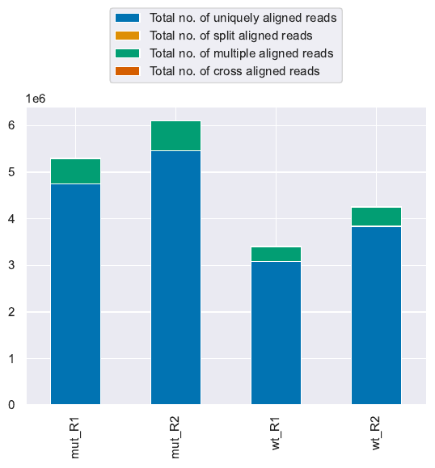
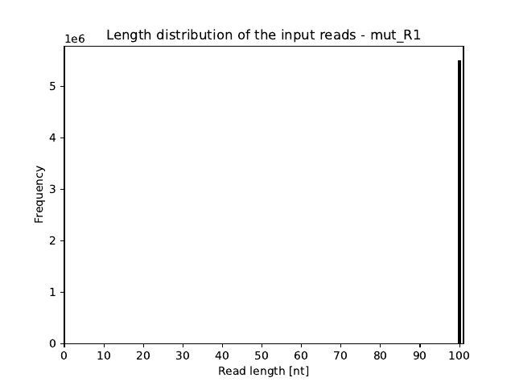
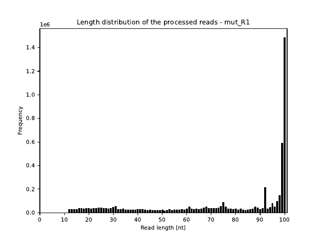
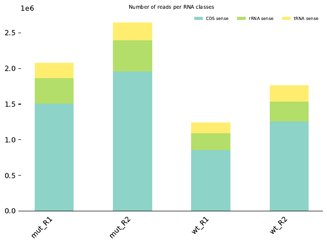
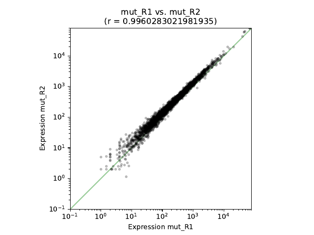
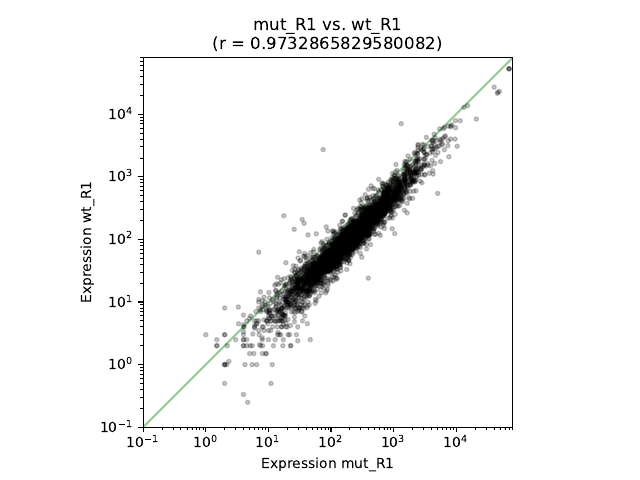
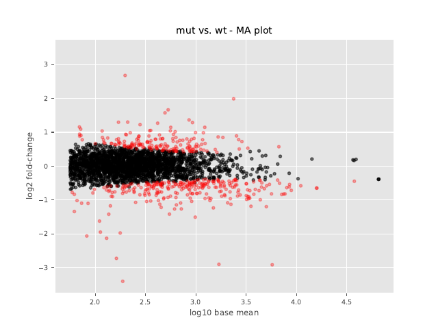
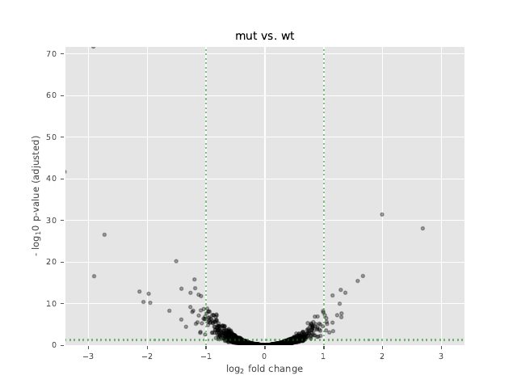
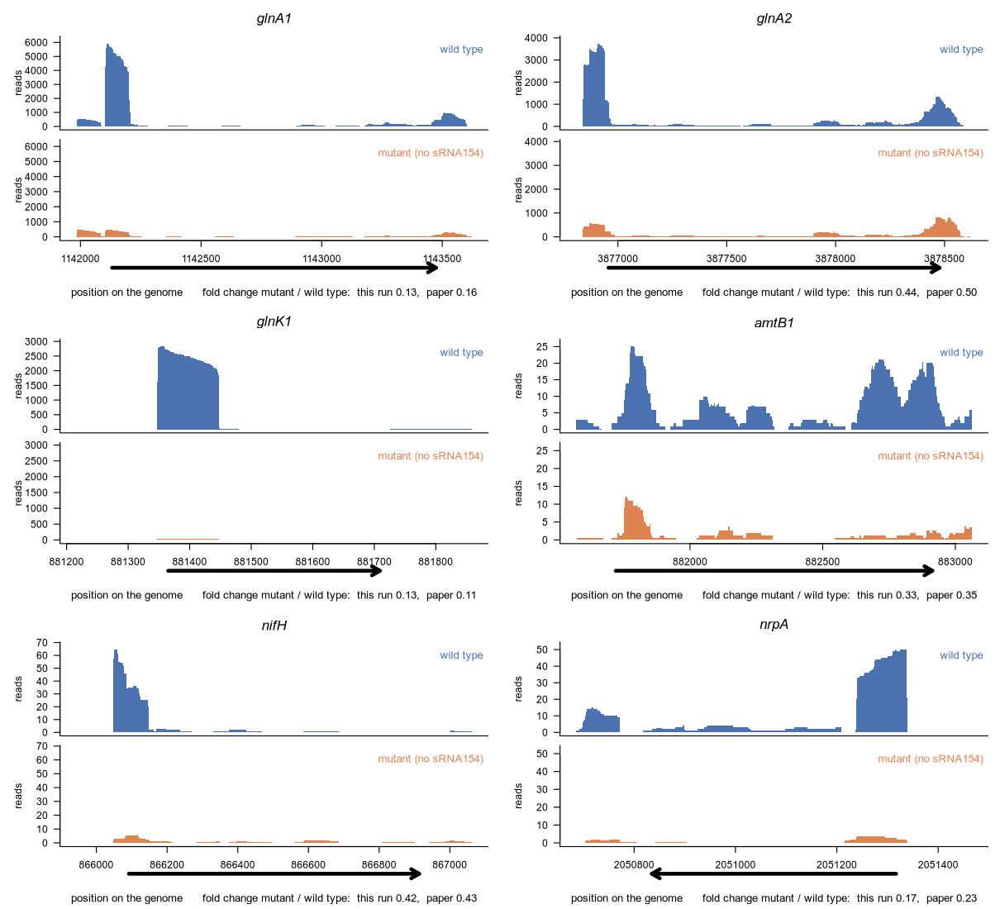

# Results: Example 02, sRNA154 in *Methanosarcina mazei*

This page explains what the analysis found and how to read every plot. You do
not need to run anything to follow it.

All numbers come from one complete run of [`rnaseq.sh`](../rnaseq.sh) with
READemption 2.0.4. If you run the script yourself you should get the same
numbers.

## The short version

- **What was compared:** the archaeon *Methanosarcina mazei* Gö1 with and
  without the small RNA sRNA154, two samples (replicates) of each.
  - `wt`: wild type, the normal strain
  - `mut`: mutant, the strain in which sRNA154 was deleted
- **Why:** the paper this example follows (Prasse et al. 2017) describes
  sRNA154 as a regulator of nitrogen fixation, the ability to use nitrogen
  gas from the air.
- **Purpose of this example:** to reproduce a published result. We take the
  paper's public raw reads and run them through the same chain of tools
  (READemption, segemehl, DESeq2) in their current versions, then check
  whether we arrive at the paper's findings. The old software versions of
  2017 are deliberately not installed (see "How this run differs from the
  paper's method" in section 6).
- **Data quality:** 88 to 90 % of the reads could be placed on the genome,
  and the replicates agree very well.
- **Main result:** deleting sRNA154 changes few genes. Of 2,771 genes that
  could be tested, 53 changed at least two-fold: 19 became more active and
  34 less active in the mutant.
- **Does it make sense?** Yes. The clearest losers in the mutant are genes
  of nitrogen metabolism: glutamine synthetase (`glnA`), a P-II nitrogen
  regulator and two ammonium transporters.
- **Does it match the paper?** Largely yes. All seven nitrogen genes in the
  paper's Table 1 go down in our run too, with nearly the same fold
  changes. Of the paper's complete list of 62 changed genes, 52 are
  reproduced, 9 are not and 1 cannot be compared (section 6).

## Words used on this page

| Word | Meaning |
|---|---|
| Read | One short piece of RNA sequence produced by the sequencing machine. Here each read is 100 letters long. |
| Aligning | Finding the place on the genome a read came from. |
| Replicate | A repeat of the same experiment. Two replicates that agree show that a result is not an accident. |
| Expression | How active a gene is. More reads from a gene means higher expression. |
| Fold change | How many times more (or less) active a gene is in one condition than in the other. |
| log2 fold change | The fold change on a doubling scale: +1 means twice as much, +2 four times, +3 eight times; -1 means half as much. 0 means no change. |
| p-value | The chance of seeing a difference this large if there were really no difference. Small is convincing. |
| padj | The p-value corrected for the fact that thousands of genes are tested at once. This is the one to use. Below 0.05 is the usual cut-off. |

## 1. How good are the raw reads?

Open [`multiqc_report.html`](multiqc_report.html) in a web browser (download
it first; GitHub shows only its source code). It is a report made by the
programs FastQC and MultiQC, which examine the reads before any analysis.

| Sample | Reads | Read length | GC content | Reads that occur more than once |
|---|---|---|---|---|
| mut_R1 | 5,988,519 | 100 | 39 % | 84 % |
| mut_R2 | 6,824,347 | 100 | 39 % | 83 % |
| wt_R1 | 3,767,973 | 100 | 41 % | 86 % |
| wt_R2 | 4,776,112 | 100 | 40 % | 82 % |

**What it shows.**

- The quality of the letters ("per base sequence quality") passes in all
  four samples. This is the most important check.
- FastQC marks five other checks as failed: sequence content, GC content,
  duplication, over-represented sequences and adapter content. This looks
  alarming but is common for RNA-seq. FastQC was designed for genome
  sequencing, where every part of the genome should appear about equally
  often. In RNA-seq a few very active genes produce a large share of the
  reads, so the same sequences appear again and again.
- The adapter warning means that some reads still carry a piece of the
  artificial sequence added in the laboratory. This analysis does not remove
  adapters separately; it trims read ends by quality only. Since about 90 %
  of the reads still align, the effect is limited, but it is one reason why
  some reads are lost (section 2).

## 2. Were the reads placed on the genome?

**How to read it.** One bar per sample. The height is the number of reads
that were aligned (the scale `1e6` means millions). The colours split each
bar:

- **blue**: reads that fit exactly one place on the genome ("uniquely aligned")
- **green**: reads that fit several places equally well ("multiple aligned")

**What it shows.**

| Sample | Reads | Too short after cleaning | Aligned | Aligned to one place only |
|---|---|---|---|---|
| mut_R1 | 5,988,519 | 486,184 | 88.5 % | 89.7 % |
| mut_R2 | 6,824,347 | 542,669 | 89.5 % | 89.5 % |
| wt_R1 | 3,767,973 | 287,224 | 90.4 % | 90.6 % |
| wt_R2 | 4,776,112 | 376,565 | 89.1 % | 90.2 % |

About nine in ten reads were aligned, and about nine in ten of those fit a
single place, which is a good result. Most of the reads that were lost were
removed during cleaning because they became too short (about 8 % of each
sample).

The bars have different heights because the samples have different numbers
of reads; the mutant samples were sequenced more deeply. That is not a
problem: DESeq2 corrects for it before comparing.

## 3. How long are the reads?

Before cleaning:

After cleaning:

**How to read it.** The horizontal axis is the read length in letters
(nucleotides, "nt"). The height of a bar is the number of reads with that
length. The plots show sample mut_R1; the PDF files have one page per sample.

**What it shows.** Before cleaning, every read is exactly 100 letters long.
Cleaning cuts low-quality letters (quality below 25) and runs of A's off the
read ends. Most reads stay at or close to 100 letters. A smaller part is
spread over all shorter lengths, and reads shorter than 12 letters are
thrown away.

## 4. What kind of RNA do the reads come from?

**How to read it.** One bar per sample, split by the kind of gene the reads
landed on:

- **turquoise (CDS)**: protein-coding genes, the ones we are interested in
- **green (rRNA)**: ribosomal RNA
- **yellow (tRNA)**: transfer RNA

**What it shows.**

| Sample | Protein-coding genes | rRNA | tRNA |
|---|---|---|---|
| mut_R1 | 1,510,233 | 357,016 | 210,785 |
| mut_R2 | 1,960,734 | 431,797 | 253,716 |
| wt_R1 | 859,197 | 231,872 | 154,786 |
| wt_R2 | 1,258,281 | 274,922 | 230,004 |

About 70 % of the counted reads come from protein-coding genes. That is the
opposite of example 01 and much better for the analysis: every gene is
measured from many reads, so even small changes can be detected. It
suggests that ribosomal RNA was removed in the laboratory before sequencing.

## 5. Do the replicates agree?

Two replicates of the same condition (mut_R1 against mut_R2):

Two different conditions (mut_R1 against wt_R1):

**How to read it.** Every dot is one gene. Its position to the right is the
number of reads in the first sample, its height is the number of reads in
the second sample. Both axes are logarithmic: each step (10, 100, 1,000) is
ten times more. A dot on the green diagonal line has the same activity in
both samples. The number `r` in the title is the correlation: 1 means
identical, 0 means unrelated.

**What it shows.**

- The replicates are almost identical: r = 0.996 for the two mutant samples
  and r = 0.990 for the two wild-type samples.
- Mutant against wild type is only slightly wider (r between 0.963 and
  0.980). Nearly all genes stay on the diagonal, and a few dots stand
  clearly apart from it.

This already tells the main story: deleting sRNA154 leaves most of the cell
unchanged and affects a small number of genes.

The file `expression_scatter_plots.pdf` has all twelve sample pairs.

## 6. Which genes changed?

For every gene, the program DESeq2 compares the read counts of the two
conditions and reports how big the change is (log2 fold change) and how
sure we can be about it (padj).

In this comparison, called "mut vs. wt", a **positive** log2 fold change
means the gene is **more active in the mutant**, and a **negative** one
means it is **less active in the mutant**.

### MA plot

**How to read it.** Every dot is one gene.

- Left to right: how active the gene is on average over all samples
  (logarithmic: 2 means about 100 reads, 3 about 1,000, 4 about 10,000).
- Up and down: the log2 fold change. Dots above 0 are more active in the
  mutant, dots below 0 are less active. The further from 0, the bigger the
  change.
- **Red** dots are genes with a statistically significant change
  (padj below 0.05). **Black** dots are not significant.

**What it shows.** Almost all genes lie in a flat band between -1 and +1,
so they change less than two-fold. Many dots inside the band are red:
because the replicates agree so well, even small changes are statistically
significant. Significant is not the same as large, which is why we also ask
for a two-fold change. Only a handful of dots lie far outside the band,
reaching about -3.4 (ten times less active) and +2.7 (six times more
active).

### Volcano plot

**How to read it.** Every dot is one gene.

- Left to right: the log2 fold change. Right of 0 means more active in the
  mutant, left of 0 means less active.
- Bottom to top: how convincing the change is. The axis is the negative
  logarithm of padj, so **higher means more certain** (2 corresponds to
  padj 0.01, 10 to padj 0.0000000001).
- The two vertical dotted lines mark a two-fold change (log2 fold change of
  -1 and +1). The horizontal dotted line marks padj 0.05.

A gene counts as clearly changed when it is **above the horizontal line and
outside the two vertical lines**: the upper left and upper right areas.

**What it shows.** Most genes sit in the narrow column in the middle. Only
53 genes are in the two outer areas, 34 on the left and 19 on the right.
The gene at the very top is glutamine synthetase (`glnA`), with a padj of
1.7e-72. Its dot is cut off at the upper edge of the plot.

The second volcano file, `volcano_plots_log2_fold_change_vs_p-value.pdf`,
is the same plot with the uncorrected p-value. Use the adjusted one.

### The numbers

| | Genes |
|---|---|
| Annotated genes (protein-coding, tRNA, rRNA) | 3,523 |
| Genes with enough reads to be tested | 2,771 |
| Significant (padj below 0.05) | 441 |
| Significant and at least two-fold more active in the mutant | 19 |
| Significant and at least two-fold less active in the mutant | 34 |

### Genes that became less active without sRNA154

| Gene | What it makes | log2 fold change | Times less active | padj |
|---|---|---|---|---|
| MM_RS03045 | PHP domain protein | -3.40 | about 10.6 | 2.1e-42 |
| MM_RS05025 (`glnA`) | glutamine synthetase (type I glutamate-ammonia ligase) | -2.91 | about 7.5 | 1.7e-72 |
| MM_RS03825 | P-II family nitrogen regulator | -2.90 | about 7.5 | 2.5e-17 |
| MM_RS10395 | phosphate transporter, binding protein PstS | -2.72 | about 6.6 | 2.7e-27 |
| MM_RS03030 | phosphate transporter, binding protein PstS | -2.13 | about 4.4 | 1.2e-13 |
| MM_RS01710 | HAD family hydrolase | -2.06 | about 4.2 | 3.9e-11 |
| MM_RS04990 | ammonium transporter | -1.95 | about 3.9 | 6.1e-11 |
| MM_RS03830 | ammonium transporter | -1.62 | about 3.1 | 5.1e-09 |

Four of these eight belong to nitrogen metabolism. Glutamine synthetase is
the enzyme that builds ammonium into the cell's own molecules, P-II proteins
are the sensors that report the cell's nitrogen status, and the ammonium
transporters bring ammonium into the cell. Their drop in the mutant fits the
paper's description of sRNA154 as a regulator of nitrogen metabolism.

### Genes that became more active without sRNA154

| Gene | What it makes | log2 fold change | Times more active | padj |
|---|---|---|---|---|
| MM_RS17330 | protein of unknown function (DUF2769) | 2.68 | about 6.4 | 8.2e-29 |
| MM_RS06595 | prephenate dehydrogenase | 1.99 | about 4.0 | 3.8e-32 |
| MM_RS06585 (`aroD`) | 3-dehydroquinate dehydratase | 1.66 | about 3.2 | 2.2e-17 |
| MM_RS06590 | shikimate dehydrogenase | 1.57 | about 3.0 | 3.4e-16 |
| MM_RS06580 | 3-dehydroquinate synthase II | 1.36 | about 2.6 | 2.3e-13 |
| MM_RS12580 | methylcobamide-CoM methyltransferase | 1.30 | about 2.5 | 2.2e-08 |

Four of these genes (MM_RS06580 to MM_RS06595) lie next to each other on
the genome and belong to the pathway that makes aromatic amino acids. They
rise together, as would be expected if these neighbouring genes are read
as one unit.

### Comparison with the paper

Table 1 of the paper lists seven nitrogen-metabolism genes that were less
active in the mutant. The table below puts our numbers next to the paper's.
"Fold change" here is mutant divided by wild type, so 0.13 means the gene
has 13 % of its normal activity.

| Gene | What it makes | Paper: fold change | Our run: fold change | Our run: p-value | Our run: padj |
|---|---|---|---|---|---|
| `glnK1` (MM_RS03825) | P-II nitrogen regulator | 0.11 | 0.13 | 7.3e-20 | 2.5e-17 |
| `glnA1` (MM_RS05025) | glutamine synthetase 1 | 0.16 | 0.13 | 6.3e-76 | 1.7e-72 |
| `nrpA` (MM_RS08860) | activator of the nitrogenase genes | 0.23 | 0.17 | 7.3e-18 | not given |
| `amtB2` (MM_RS04990) | ammonium transporter | 0.32 | 0.26 | 4.9e-13 | 6.1e-11 |
| `amtB1` (MM_RS03830) | ammonium transporter | 0.35 | 0.33 | 5.3e-11 | 5.1e-09 |
| `nifH` (MM_RS03765) | nitrogenase iron protein | 0.43 | 0.42 | 3.9e-05 | not given |
| `glnA2` (MM_RS16575) | glutamine synthetase 2 | 0.50 | 0.44 | 4.9e-19 | 1.5e-16 |

**All seven genes match.** Each one goes down in the mutant, as in the
paper, and the fold changes differ by 0.07 at most.

Small differences are expected, because the software has changed since
2017. The section "How this run differs from the paper's method" below
lists every difference.

**Why two genes have no padj.** `nrpA` and `nifH` have few reads (about 50
and 36 on average). DESeq2 sets genes with low counts aside before it
corrects the p-values, because they can rarely reach significance, and
writes `NA` instead of a padj. Their uncorrected p-values are still very
small, and their fold changes match the paper. This is why they are missing
from the count of 53 genes and from the red dots in the plots, although
they are two of the most important genes in the paper. When you look for a
particular gene, check the table itself and not only the padj filter.

The gene names in the paper (for example MM_732) are an older numbering.
The result table uses the current numbering (MM_RS03825); the annotation
file lists both.

### Full comparison with the paper's complete gene list

The paper's supplementary Table S1 lists every gene that changed at least
two-fold: 62 entries (60 protein-coding genes and 2 tRNAs). We compared all
of them with our run. The complete side-by-side list is in
[`paper_comparison_table_S1.csv`](paper_comparison_table_S1.csv).

| Outcome | Entries |
|---|---|
| **Reproduced**: same direction, and at least 1.5-fold in our run | 52 |
| **Not reproduced**: little or no change in our run | 9 |
| **Not comparable**: the gene (MM_0083) no longer exists in the current genome annotation | 1 |
| Total | 62 |

So 52 of the 61 comparable entries (85 %) are reproduced. For 47 of those
52, our fold change is within 15 % of the published one, and the same 47
also pass the two-fold mark in our run. The other five are just below it
(for example 1.98-fold where the paper has 2.04-fold). Over the 59
protein-coding genes that could be compared, the published and our log2
fold changes have a correlation of r = 0.94.

The nine entries that our run does not reproduce:

| Gene (paper / current) | Function given in the paper | Paper: fold change | Our run: fold change | Our run: average reads |
|---|---|---|---|---|
| MM_2699 / MM_RS13985 | transposase | 0.20 | 0.90 | 8 |
| MM_1901 / MM_RS09865 | hypothetical protein | 0.38 | 0.90 | 22 |
| MM_2833 / MM_RS14695 | ABC transporter ATP-binding protein | 0.46 | 0.83 | 370 |
| MM_0434 / MM_RS02335 | hypothetical protein | 0.46 | 0.72 | 189 |
| MM_3340 / MM_RS17345 | hypothetical protein | 0.48 | 0.82 | 116 |
| MM_0490 / MM_RS02610 | phycocyanin subunit alpha | 2.04 | 1.18 | 73 |
| MM_2775 / MM_RS14390 | hypothetical protein | 2.07 | 0.99 | 43 |
| MM_2824 / MM_RS14650 | glucose-6-phosphate dehydrogenase | 2.18 | 1.16 | 572 |
| MM_0008 / MM_RS00035 | hypothetical protein | 2.78 | 1.02 | 100 |

None of the nine is one of the nitrogen-metabolism genes the paper is
about. We did not find out why they differ. Likely causes are the newer
software and the newer genome annotation, in which the borders of some
genes were redrawn. Two of the nine have very few reads, and the first one
is a transposase, a gene that exists in several copies and is therefore
counted differently by different software versions.

Looking the other way round, our run has 53 significant genes with at
least a two-fold change. Of these, 44 are in the paper's list and 9 are
not. Those 9 are all borderline, with changes between 2.02 and 2.35-fold.

Two notes on how the comparison was made:

- The paper gives no gene number for the two tRNAs (tRNA-Asp and tRNA-Ile).
  We matched each to the copy of that tRNA that changes most in our run
  (fold change 0.43 and 0.49; the paper has 0.45 and 0.48).
- "Reproduced" uses a 1.5-fold limit instead of two-fold so that a gene
  measured at 1.98-fold is not called a failure against a published
  2.04-fold.

### The paper's Figure 3, redrawn from our run

Figure 3 is the only figure of the paper that is made from the RNA-seq
data. It shows the read coverage over six nitrogen-metabolism genes. We
redrew it from our own run with the script
[`plot_figure3_coverage.R`](../plot_figure3_coverage.R).

**How to read it.** There is one pair of plots per gene: wild type on top
(blue) and the mutant without sRNA154 below (orange). The horizontal axis
is the position on the genome. The height is the number of reads lying on
that position ("coverage"), so a tall mountain means an active gene. Both
plots of a pair use the same vertical scale, so the heights can be compared
directly. The black arrow under each pair marks where the gene lies and in
which direction it is read. As in the paper, one replicate of each strain
is shown (replicate 1). The coverage is scaled so that both samples count
as if they had the same total number of reads.

**What it shows.** In all six genes the orange mountain is clearly lower
than the blue one: each gene is less active when sRNA154 is missing, as in
the paper. The fold change under each pair is the result of DESeq2 over
both replicates, next to the value printed in the paper's figure:

| Gene | Paper | Our run |
|---|---|---|
| `glnA1` | 0.16 | 0.13 |
| `glnA2` | 0.50 | 0.44 |
| `glnK1` | 0.11 | 0.13 |
| `amtB1` | 0.35 | 0.33 |
| `nifH` | 0.43 | 0.42 |
| `nrpA` | 0.23 | 0.17 |

The vertical scales are also close to the paper's. The paper's axes go up
to 6,000 reads for `glnA1`, 3,500 for `glnA2`, 3,000 for `glnK1`, 50 for
`amtB1`, 100 for `nifH` and 80 for `nrpA`; our highest values are about
5,900, 3,700, 2,800, 25, 65 and 50.

Two things to keep in mind when reading the plots:

- The coverage is uneven along a gene. In `glnA1`, `glnA2` and `nifH` most
  reads lie at the start of the gene. The fold change is calculated from
  all reads of the gene, not from the height of the tallest point.
- `amtB1`, `nifH` and `nrpA` have few reads (note the scales of 25 to 70),
  so their plots look rougher than those of the highly active genes.

### Which figures of the paper can be reproduced

The paper has seven figures and three tables in its main text. Most of
them show laboratory experiments, which cannot be repeated from sequencing
data. This is what each one is made from:

| Paper item | What it shows | Made from | Reproduced here? |
|---|---|---|---|
| Figure 1 | Position of sRNA154 on the genome, its promoter, and its read coverage with and without nitrogen | RACE mapping, sequence alignment, RNA-seq of the wild type under two nitrogen conditions | No. All four samples of our dataset were grown under nitrogen limitation. |
| Figure 2 | sRNA154 is conserved in related *Methanosarcina* species | Structure alignment and prediction programs | No. A separate sequence analysis, not RNA-seq. |
| Figure 3 | Read coverage over six nitrogen genes, wild type and mutant | The RNA-seq data used here | **Yes**, see above |
| Figure 4 | How fast the target mRNAs decay | Laboratory (actinomycin D, qRT-PCR) | No, laboratory work |
| Figure 5 | Amount of NifH protein | Laboratory (western blot) | No, laboratory work |
| Figure 6 | Predicted binding sites of sRNA154 | Prediction program (IntaRNA) | No. A separate prediction, not RNA-seq. |
| Figure 7 | sRNA154 binding to target mRNAs | Laboratory (gel shift assay) | No, laboratory work |
| Table 1 | Fold changes of seven nitrogen genes | RNA-seq, plus a qRT-PCR column | **Yes**, the RNA-seq column: 7 of 7 |
| Table 2 | Effect of sRNA154 variants on target stability | Laboratory (qRT-PCR) | No, laboratory work |
| Table 3 | Predicted targets of sRNA154 | Prediction program (IntaRNA) | No. A separate prediction, not RNA-seq. |
| Table S1 | Complete list of changed genes | RNA-seq | **Yes**: 52 of 62 |

So everything in the paper that is based on this RNA-seq dataset has been
compared: Table 1, Table S1 and Figure 3.

### How this run differs from the paper's method

The aim of this example is to **reproduce** the paper: same raw reads, same
chain of tools, and then a check whether the same genes come out. It is not
an exact replay. The paper was analysed in 2017 with the software of that
time. We use the current versions on purpose, because that is what anyone
repeating the analysis today would install, and a result that only appears
with one old software version would not be a robust result.

The table lists every step, taken from the paper's Materials and Methods
and from [`rnaseq.sh`](../rnaseq.sh).

| Step | Paper (2017) | This run | Same? |
|---|---|---|---|
| Raw reads | Single-end reads, deposited in a public archive | The same deposited reads, downloaded from ENA | yes |
| Quality trimming | A separate program (FASTX `fastq_quality_trimmer`), quality cut-off 20 | Done inside READemption, quality cut-off 25 | no |
| Removal of poly-A tails | yes | yes | yes |
| Shortest read kept | 12 letters | 12 letters (READemption's default) | yes |
| READemption | 0.3.0 | 2.0.4 | no |
| Aligner | segemehl 0.1.7, accuracy setting not stated | segemehl 0.3.4, accuracy 95 % | no |
| Genome sequence | NC_003901.1 | NC_003901.1 | yes |
| Gene list (annotation) | NCBI annotation of that time, plus sRNAs and UTRs added by hand | Current NCBI annotation, nothing added by hand | no |
| Kinds of gene counted | not stated | protein-coding genes, tRNAs, rRNAs | unknown |
| DESeq2 | 1.4.5 | 1.42.0 | no |
| A gene counts as changed when | at least two-fold and padj below 0.1 | at least two-fold and padj below 0.05 | no |

What these differences mean:

- **Software versions.** About ten years lie between the versions. The way
  DESeq2 calculates fold changes and padj was revised in that time, and the
  aligner places some reads differently. This can move a gene that sits
  close to the two-fold line to the other side of it.
- **Annotation.** NCBI has revised the gene list of this genome since 2017.
  Some gene borders moved and some genes were removed. This is why one gene
  of the paper (MM_0083) cannot be compared at all.
- **Significance cut-off.** Ours is stricter than the paper's. We checked
  whether this matters; see below.

**Check: the paper's cut-off applied to our run.** We filtered our result
table a second time with the paper's cut-off (padj below 0.1). Nothing was
recalculated and no result file was replaced: the padj values in the table
do not depend on the cut-off, only the filter does.

| | Our cut-off (padj below 0.05) | Paper's cut-off (padj below 0.1) |
|---|---|---|
| Significant genes | 441 | 594 |
| Significant and at least two-fold changed | 53 | 53 |
| of these, more active in the mutant | 19 | 19 |
| of these, less active in the mutant | 34 | 34 |
| of these, in the paper's list | 44 | 44 |

The looser cut-off adds 153 significant genes, but every one of them
changes less than two-fold. The list of 53 two-fold genes is identical with
both cut-offs. **The cut-off therefore does not explain any difference from
the paper.**

**What is still open.** For the nine entries that are not reproduced, the
remaining candidates are the software versions and the annotation. Which of
them is responsible was not tested. That would need the 2017 versions,
which are hard to install today and are deliberately left out of this
project. The conclusion stands without them: with current software, the
paper's central finding (the nitrogen-metabolism genes go down when sRNA154
is missing) and 52 of its 62 changed genes are reproduced.

The notation `1.7e-72` means a decimal point followed by 71 zeros and then
17: the number after `e-` says how many places the decimal point moves to
the left.

## Files in this folder

| File | Content |
|---|---|
| `multiqc_report.html` | Read-quality report of section 1. Download it and open it in a web browser. |
| `read_alignment_stats.csv` | All alignment numbers per sample. Opens in Excel or LibreOffice (tab-separated). |
| `deseq_comp_mut_vs_wt_with_annotation_and_countings.csv` | One row per gene: position, description, raw read counts of the four samples, `log2FoldChange`, `pvalue` and `padj`. This is the main result table. |
| `deseq_comp_wt_vs_mut_with_annotation_and_countings.csv` | The same comparison the other way round, so every fold change has the opposite sign. |
| `paper_comparison_table_S1.csv` | Every gene of the paper's supplementary Table S1 next to our result, with a verdict (section 6). |
| `methanosarcina_aligned_reads.pdf` | Plot of section 2 |
| `input_reads_length_distributions.pdf`, `processed_reads_length_distributions.pdf` | Plots of section 3, one page per sample |
| `rna_class_sizes.pdf` | Plot of section 4 |
| `expression_scatter_plots.pdf` | Plots of section 5, all twelve sample pairs |
| `MA_plots.pdf` | MA plots of section 6, one page per direction of the comparison |
| `volcano_plots_log2_fold_change_vs_adjusted_p-value.pdf` | Volcano plots of section 6 |
| `volcano_plots_log2_fold_change_vs_p-value.pdf` | Volcano plots with the uncorrected p-value |
| `figure3_coverage.pdf` | The paper's Figure 3 redrawn from our run (section 6), made by `plot_figure3_coverage.R` |
| `figures/` | The pictures shown on this page, made from the PDF files |

## What to keep in mind

- There are only **two replicates** per condition. That is the minimum for
  statistics. Three or more make the results more reliable.
- The comparison with the paper (section 6) covers every gene in the
  paper's Table 1 and supplementary Table S1. Nine of the 61 comparable
  entries are not reproduced. The significance cut-off was ruled out as
  the reason; software versions and annotation were not tested.
- This run uses newer software than the paper on purpose (section 6, "How
  this run differs from the paper's method").
- sRNA154 itself is not in the gene list, because only protein-coding
  genes, tRNAs and rRNAs were counted.
- The biological remarks on this page are based on the gene descriptions in
  the annotation file.

## Reference

Prasse D, Förstner KU, Jäger D, Backofen R, Schmitz RA (2017). sRNA154 a
newly identified regulator of nitrogen fixation in *Methanosarcina mazei*
strain Gö1. *RNA Biology* 14:1544-1558.
[doi:10.1080/15476286.2017.1306170](https://doi.org/10.1080/15476286.2017.1306170)
