# Results: Example 03, *Rhizobium tropici* with apigenin and with salt

This page explains what the analysis found and how to read every plot. You do
not need to run anything to follow it.

All numbers come from a complete run of [`rnaseq.sh`](../rnaseq.sh) with
READemption 2.0.4. If you run the script yourself you should get the same
numbers.

## The short version


- **What was compared:** the bacterium *Rhizobium tropici* CIAT 899 grown in
  three ways, two samples (replicates) of each.
  - `control`: normal medium
  - `apigenin`: medium with apigenin, a signal molecule that plant roots
    release
  - `salt`: medium with extra salt
- **Why:** *Rhizobium* lives in the root nodules of beans and supplies the
  plant with nitrogen. To start this partnership the bacterium switches on
  its nodulation genes (`nod` genes). The paper this example follows
  (Pérez-Montaño et al. 2016) reports that this strain switches them on not
  only with the plant signal apigenin but also with salt.
- **Purpose of this example:** to reproduce a published result from
  **paired-end** reads, in which every piece of RNA is read from both ends.
  Examples 01 and 02 use single-end reads.
- **Data quality:** 93 to 97 % of the reads could be placed on the genome.
  But more than 90 % of them come from ribosomal RNA, which fits several
  places on the genome and tells us nothing about gene activity. Only a
  small part of the data measures the genes we are interested in.
- **Main result, apigenin:** 7 genes changed, all of them at least four-fold
  more active. All 7 lie on the symbiotic plasmid and belong to the two
  groups of `nod` genes.
- **Main result, salt:** 134 protein-coding genes changed at least
  four-fold: 113 became more active and 21 less active. The `nod` genes are
  among the strongest risers, as with apigenin.
- **Does it match the paper?** For the paper's central finding, yes. The
  fold changes of the nodulation genes are close to the published ones, and
  nearly every gene the paper reports as more active is more active in our
  run too. The paper's long list of genes that become *less* active with
  salt is only partly reproduced (section 6).

## Words used on this page

| Word | Meaning |
|---|---|
| Read | One short piece of RNA sequence produced by the sequencing machine. Here each read is 101 letters long. |
| Paired-end | Every piece of RNA was read from both ends, so each piece gives two reads (a pair). |
| Fragment | The piece of RNA between the two reads of a pair. In a paired-end analysis we count fragments, not single reads. |
| Aligning | Finding the place on the genome a read came from. |
| Replicate | A repeat of the same experiment. Two replicates that agree show that a result is not an accident. |
| Replicon | One of the separate DNA molecules of the cell. This strain has four: one chromosome and three plasmids. |
| Symbiotic plasmid | The plasmid that carries the genes for living with the plant (here plasmid B, `NC_020061.1`). |
| Expression | How active a gene is. More fragments from a gene means higher expression. |
| Fold change | How many times more (or less) active a gene is in one condition than in the other. |
| log2 fold change | The fold change on a doubling scale: +1 means twice as much, +2 four times, +3 eight times; -1 means half as much. 0 means no change. |
| p-value | The chance of seeing a difference this large if there were really no difference. Small is convincing. |
| padj | The p-value corrected for the fact that thousands of genes are tested at once. This is the one to use. Below 0.05 is the usual cut-off. |

## 1. How good are the raw reads?

Open [`multiqc_report.html`](multiqc_report.html) in a web browser (download
it first; GitHub shows only its source code). It is a report made by the
programs FastQC and MultiQC, which examine the reads before any analysis.
Every sample has two files, `_p1` and `_p2`, one for each end of the pairs.

| Sample | Read pairs | Read length | GC content | Reads that occur more than once (`_p1` / `_p2`) |
|---|---|---|---|---|
| apigenin_R1 | 28,555,060 | 101 | 52 to 53 % | 95 % / 85 % |
| apigenin_R2 | 11,882,481 | 101 | 52 to 53 % | 99 % / 98 % |
| control_R1 | 26,737,418 | 101 | 52 to 53 % | 96 % / 85 % |
| control_R2 | 11,344,704 | 101 | 52 to 53 % | 99 % / 98 % |
| salt_R1 | 24,531,550 | 101 | 52 % | 96 % / 85 % |
| salt_R2 | 10,284,287 | 101 | 52 to 53 % | 99 % / 98 % |

**What it shows.**

- The quality of the letters ("per base sequence quality") passes in all
  twelve files. This is the most important check.
- The first replicates (R1) have more than twice as many read pairs as the
  second replicates (R2). That is not a problem: DESeq2 corrects for it
  before comparing.
- Almost every read occurs more than once (85 to 99 %), and FastQC marks
  the duplication check as failed in all files. This is the first sign of
  what section 2 confirms: a few RNA molecules, the ribosomal RNAs, make up
  nearly all of the data.
- FastQC also gives warnings or failures for sequence content, GC content
  and over-represented sequences in some files. They have the same cause.
  The adapter check passes in all files.

## 2. Were the reads placed on the genome?

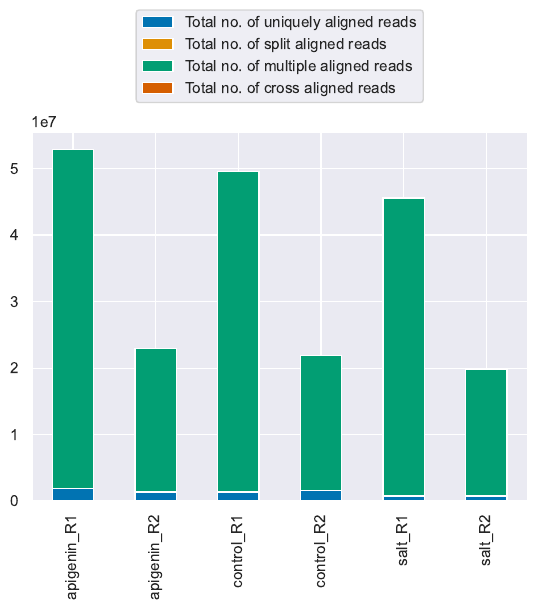

**How to read it.** One bar per sample. The height is the number of reads
that were aligned (the scale `1e7` means tens of millions; both reads of a
pair are counted). The colours split each bar:

- **blue**: reads that fit exactly one place on the genome ("uniquely aligned")
- **green**: reads that fit several places equally well ("multiple aligned")

**What it shows.**

| Sample | Reads (both ends) | Aligned | Aligned to one place only | Fragments built from the pairs |
|---|---|---|---|---|
| apigenin_R1 | 57,110,120 | 92.6 % | 3.7 % | 26,449,154 |
| apigenin_R2 | 23,764,962 | 96.6 % | 6.2 % | 11,487,082 |
| control_R1 | 53,474,836 | 92.7 % | 2.8 % | 24,798,584 |
| control_R2 | 22,689,408 | 96.7 % | 7.6 % | 10,971,910 |
| salt_R1 | 49,063,100 | 92.9 % | 1.8 % | 22,782,207 |
| salt_R2 | 20,568,574 | 96.5 % | 4.1 % | 9,922,808 |

Nearly all reads were aligned, so the reads do come from this genome. But
the bars are almost completely green: only 2 to 8 % of the aligned reads
fit a single place. In examples 01 and 02 that share is about 90 %.

The reason is ribosomal RNA. The genome carries three copies of the
ribosomal RNA genes, so a read from ribosomal RNA fits several places
equally well. Section 4 shows that these reads are indeed ribosomal RNA.

The last column counts fragments. A fragment is made from the two reads of
a pair that lie close together on the genome (at most 1,000 letters
apart), so there are about half as many fragments as aligned reads. The
complete fragment numbers are in
[`fragment_alignment_stats.csv`](fragment_alignment_stats.csv).

## 3. How long are the reads?

Before cleaning:

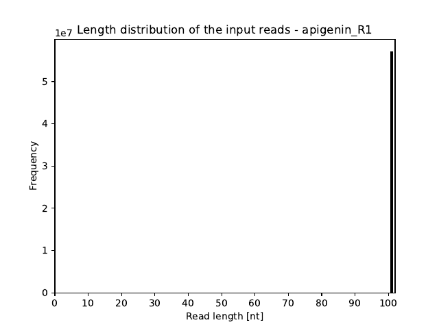

After cleaning:

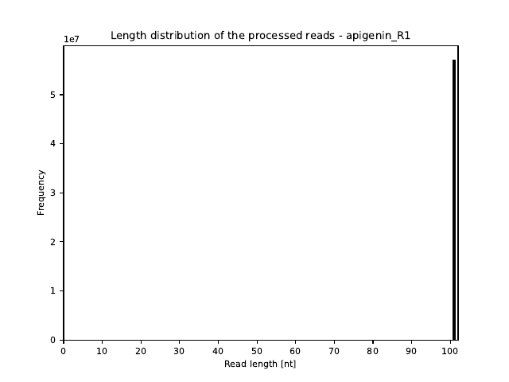

**How to read it.** The horizontal axis is the read length in letters
(nucleotides, "nt"). The height of a bar is the number of reads with that
length. The plots show sample apigenin_R1; the PDF files have one page per
sample.

**What it shows.** Every read is exactly 101 letters long, before and
after cleaning. In this run the cleaning step changed nothing: the
statistics table lists all reads as "unmodified" and none as "removed as
too short". This is different from examples 01 and 02, where cleaning
shortens many reads. Since 93 to 97 % of the reads align at full length,
the reads did not need shortening.

## 4. What kind of RNA do the fragments come from?

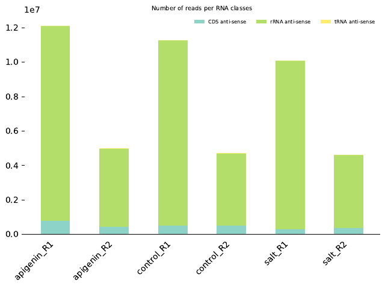

**How to read it.** One bar per sample, split by the kind of gene the
fragments landed on:

- **turquoise (CDS)**: protein-coding genes, the ones we are interested in
- **green (rRNA)**: ribosomal RNA
- **yellow (tRNA)**: transfer RNA (too few to be visible)

The word "anti-sense" in the legend is explained in the note below.

**What it shows.**

| Sample | Protein-coding genes | rRNA | tRNA | Share of protein-coding genes |
|---|---|---|---|---|
| apigenin_R1 | 774,803 | 11,350,223 | 468 | 6.4 % |
| apigenin_R2 | 454,124 | 4,565,970 | 740 | 9.0 % |
| control_R1 | 526,632 | 10,747,636 | 388 | 4.7 % |
| control_R2 | 503,235 | 4,237,665 | 1,041 | 10.6 % |
| salt_R1 | 284,731 | 9,809,823 | 392 | 2.8 % |
| salt_R2 | 354,299 | 4,252,838 | 373 | 7.7 % |

Between 89 and 97 % of the counted fragments come from ribosomal RNA. The
paper states that ribosomal RNA was removed in the laboratory before
sequencing; these numbers show that most of it was still there.

What this means for the analysis: of 10 to 29 million read pairs per
sample, only 0.3 to 0.8 million fragments measure protein-coding genes.
That is spread over 6,346 genes, so many genes have only a handful of
fragments. Small changes cannot be detected with so little data; only
large and clear ones can. Keep this in mind in section 6.

**Why "anti-sense".** In this experiment the reads point in the opposite
direction to the gene they come from. That is a property of the laboratory
method used to prepare the samples. The script therefore counts the
fragments that point the "wrong" way (option `--antisense_only`).

## 5. Do the replicates agree?

Two replicates of the same condition (apigenin_R1 against apigenin_R2):

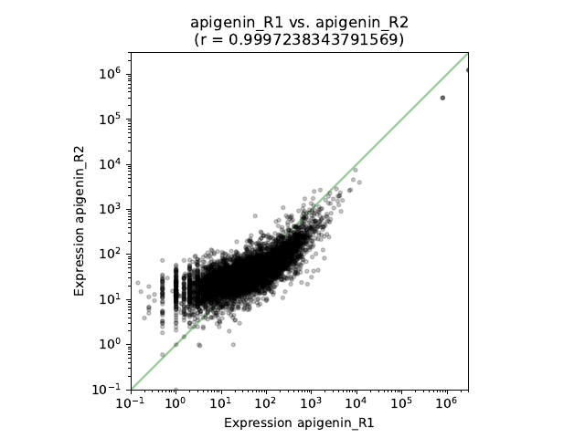

Two different conditions (apigenin_R1 against control_R1):

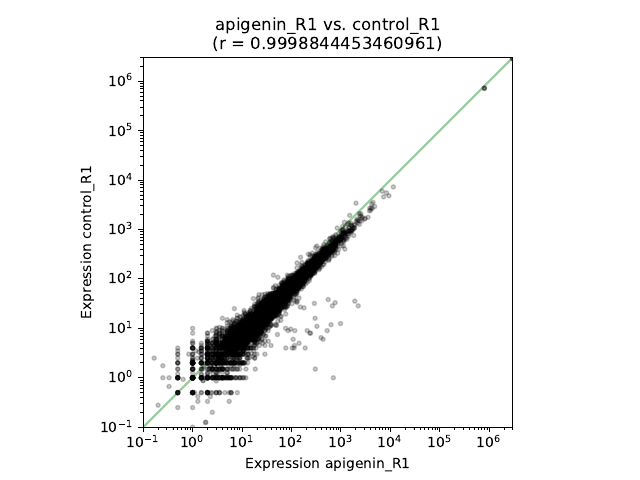

**How to read it.** Every dot is one gene. Its position to the right is the
number of fragments in the first sample, its height is the number of
fragments in the second sample. Both axes are logarithmic: each step (10,
100, 1,000) is ten times more. A dot on the green diagonal line has the
same activity in both samples. The number `r` in the title is the
correlation: 1 means identical, 0 means unrelated.

**What it shows.**

- Every pair of samples has r = 0.999 or higher. **Do not trust this
  number here.** It is produced almost entirely by the two dots at the far
  upper right. These are the ribosomal RNA genes, with about a million
  fragments each, and they are high in every sample.
- Look at the cloud of dots instead. In the replicate plot the cloud is
  wide and bends away from the diagonal for genes with few fragments. The
  two replicates agree only roughly. They were sequenced to very different
  depths and contain different shares of ribosomal RNA (section 4).

This matters for section 6. DESeq2 judges a change against the
disagreement between replicates. When replicates disagree this much, only
large changes can pass as significant.

The file `expression_scatter_plots.pdf` has all thirty sample pairs.

## 6. Which genes changed?

For every gene, the program DESeq2 compares the fragment counts of two
conditions and reports how big the change is (log2 fold change) and how
sure we can be about it (padj).

With three conditions there are three comparisons. This page describes the
two that the paper is about:

- **apigenin vs. control**: what apigenin changes
- **salt vs. control**: what salt changes

The third one, apigenin vs. salt, is in the result tables too. In every
comparison "A vs. B", a **positive** log2 fold change means the gene is
**more active in A**.

We use the paper's rule for a clear change: **at least four-fold** (log2
fold change of +2 or more, or -2 or less). On top of that we ask for a
padj below 0.05.

### MA plots

Apigenin against control:

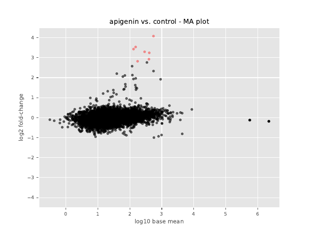

Salt against control:

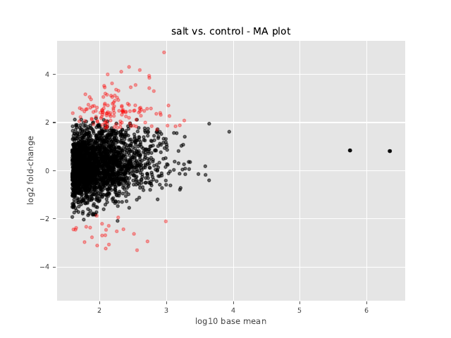

**How to read it.** Every dot is one gene.

- Left to right: how active the gene is on average over all samples
  (logarithmic: 1 means about 10 fragments, 2 about 100, 3 about 1,000).
- Up and down: the log2 fold change. Dots above 0 are more active with the
  treatment, dots below 0 are less active.
- **Red** dots are genes with a statistically significant change
  (padj below 0.05). **Black** dots are not significant.
- The two dots far to the right are the ribosomal RNA genes.

**What it shows.**

- **Apigenin:** almost all genes lie in a flat band around 0. Apigenin
  leaves the cell nearly unchanged. Seven red dots stand out at the top,
  between +2.8 and +4.1 (7 to 17 times more active).
- **Salt:** the cloud is much taller, so salt changes many more genes.
  Most red dots are above +2. A smaller group lies below -2.
- The salt plot starts further to the right than the apigenin plot. DESeq2
  sets genes with few fragments aside before testing, and in the salt
  comparison it set aside every gene with fewer than about 39 fragments on
  average. Only 2,430 of 6,409 genes were tested there.

### Volcano plots

Apigenin against control:

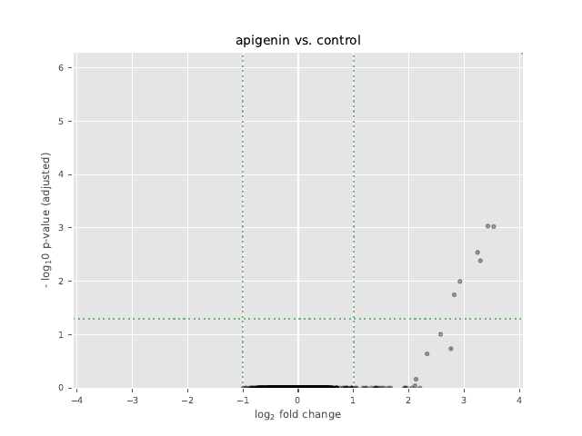

Salt against control:

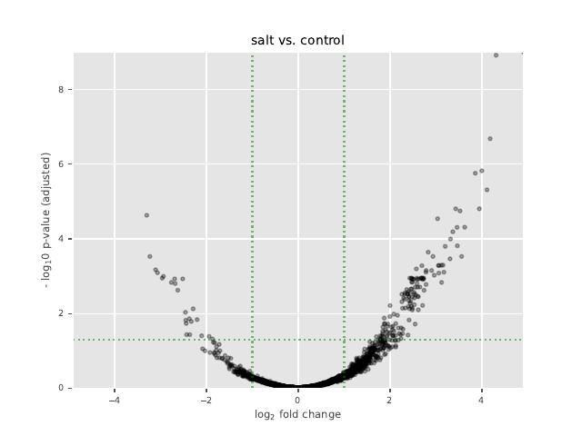

**How to read it.** Every dot is one gene.

- Left to right: the log2 fold change. Right of 0 means more active with
  the treatment, left of 0 means less active.
- Bottom to top: how convincing the change is. The axis is the negative
  logarithm of padj, so **higher means more certain** (2 corresponds to
  padj 0.01).
- The two vertical dotted lines mark a two-fold change (log2 fold change of
  -1 and +1). The horizontal dotted line marks padj 0.05.

**What it shows.**

- **Apigenin:** all genes lie flat on the bottom line except a few on the
  right. Seven of them are above the horizontal line.
- **Salt:** the dots form a wide "U". The right arm (more active with
  salt) is much fuller than the left arm.
- In both plots a gene needs a large fold change before it rises above the
  horizontal line. That is the effect described in sections 4 and 5: with
  little data per gene and replicates that agree only roughly, small
  changes cannot be told apart from chance.

The second volcano file, `volcano_plots_log2_fold_change_vs_p-value.pdf`,
is the same plot with the uncorrected p-value. Use the adjusted one.

### The numbers

| | apigenin vs. control | salt vs. control |
|---|---|---|
| Annotated genes (protein-coding, tRNA, rRNA) | 6,409 | 6,409 |
| Genes with enough fragments to be tested | 6,400 | 2,430 |
| Significant (padj below 0.05) | 7 | 160 |
| Significant and at least four-fold more active | 7 | 113 |
| Significant and at least four-fold less active | 0 | 21 |

Where the four-fold genes lie:

| Replicon | apigenin | salt |
|---|---|---|
| Chromosome (`NC_020059.1`) | 0 | 84 |
| Plasmid A (`NC_020060.1`) | 0 | 0 |
| Plasmid B, the symbiotic plasmid (`NC_020061.1`) | 7 | 23 |
| Plasmid C (`NC_020062.1`) | 0 | 27 |

### Genes that became more active with apigenin

These are all seven. The paper's gene names are given where the current
annotation has none.

| Gene | Name in the paper | What it makes | log2 fold change | Times more active | padj |
|---|---|---|---|---|---|
| RTCIAT899_RS20545 | `nodA2` | NodA family N-acyltransferase | 4.08 | about 17 | 5.1e-07 |
| RTCIAT899_RS20555 | `nodF` | acyl carrier protein | 3.54 | about 12 | 9.5e-04 |
| RTCIAT899_RS20745 | `nodB` | chitooligosaccharide deacetylase NodB | 3.43 | about 11 | 9.3e-04 |
| RTCIAT899_RS20560 | `nodE` | beta-ketoacyl-[acyl-carrier-protein] synthase | 3.29 | about 10 | 4.1e-03 |
| RTCIAT899_RS20550 | `hsnT` | acyltransferase family protein | 3.24 | about 9 | 2.9e-03 |
| RTCIAT899_RS20750 | `nodC` | chitooligosaccharide synthase NodC | 2.93 | about 8 | 1.0e-02 |
| RTCIAT899_RS20740 | `nodA1` | NodA family N-acyltransferase | 2.82 | about 7 | 1.8e-02 |

All seven are nodulation genes. They belong to two groups of neighbouring
genes on the symbiotic plasmid: `nodA2`-`hsnT`-`nodF`-`nodE`, and the start
of `nodA1`-`nodB`-`nodC`. Their products build the Nod factor, the signal
molecule that the bacterium sends back to the plant. So the plant signal
apigenin switches on exactly the genes that answer the plant.

### Genes that became more active with salt

The ten strongest of 113:

| Gene | Name in the paper | What it makes | log2 fold change | Times more active | padj |
|---|---|---|---|---|---|
| RTCIAT899_RS20960 | PB01545 | phytanoyl-CoA dioxygenase family protein | 4.91 | about 30 | 9.9e-10 |
| RTCIAT899_RS02515 | | EF-hand domain-containing protein | 4.31 | about 20 | 1.2e-09 |
| RTCIAT899_RS20750 | `nodC` | chitooligosaccharide synthase NodC | 4.18 | about 18 | 2.1e-07 |
| RTCIAT899_RS28650 | | DegQ family serine endoprotease | 4.11 | about 17 | 4.8e-06 |
| RTCIAT899_RS20745 | `nodB` | chitooligosaccharide deacetylase NodB | 4.00 | about 16 | 1.5e-06 |
| RTCIAT899_RS26950 | | dicarboxylate/amino acid:cation symporter | 3.94 | about 15 | 1.6e-05 |
| RTCIAT899_RS20760 | `nodU` | nodulation protein NodU | 3.85 | about 14 | 1.7e-06 |
| RTCIAT899_RS20555 | `nodF` | acyl carrier protein | 3.62 | about 12 | 4.9e-05 |
| RTCIAT899_RS20095 | `y4wE` | pyridoxal phosphate-dependent aminotransferase | 3.56 | about 12 | 3.0e-04 |
| RTCIAT899_RS28440 | | YceI family protein | 3.52 | about 12 | 1.8e-05 |

Three things stand out among the 113 genes:

- **The nodulation genes rise with salt too**, and by more than with
  apigenin. This is the paper's central finding.
- **`y4wE`** belongs to a group of genes for making the plant hormone
  indole-3-acetic acid, which the paper also reports as switched on.
- **Ribosomal proteins.** Of the 58 genes for ribosomal proteins, 45 are
  significantly more active with salt and none is less active. The paper
  reports the same.

### Genes that became less active with salt

The ten strongest of 21:

| Gene | What it makes | log2 fold change | Times less active | padj |
|---|---|---|---|---|
| RTCIAT899_RS27050 | helix-turn-helix transcriptional regulator | -3.30 | about 10 | 2.3e-05 |
| RTCIAT899_RS27025 | capsular polysaccharide biosynthesis protein | -3.23 | about 9 | 3.0e-04 |
| RTCIAT899_RS27020 | glycosyltransferase family 4 protein | -3.11 | about 9 | 6.7e-04 |
| RTCIAT899_RS27055 | polysaccharide biosynthesis/export family protein | -3.06 | about 8 | 8.1e-04 |
| RTCIAT899_RS27010 | DUF6270 domain-containing protein | -2.96 | about 8 | 1.1e-03 |
| RTCIAT899_RS26975 | outer membrane protein | -2.93 | about 8 | 1.0e-03 |
| RTCIAT899_RS26990 | hypothetical protein | -2.76 | about 7 | 1.5e-03 |
| RTCIAT899_RS27000 | KpsE/RkpR family capsule polysaccharide export protein | -2.69 | about 6 | 1.2e-03 |
| RTCIAT899_RS27035 | KpsE/RkpR family capsule polysaccharide export protein | -2.68 | about 6 | 1.6e-03 |
| RTCIAT899_RS27015 | FkbM family methyltransferase | -2.62 | about 6 | 2.4e-03 |

All ten lie next to each other on plasmid C (RTCIAT899_RS26975 to
RTCIAT899_RS27055), and 16 of the 21 genes come from this one region. The
genes make and export the capsule, a layer of sugar chains around the
cell. The paper reports the same region as switched off by salt ("genes of
the family bexC/ctrB/kpsE").

### Comparison with the paper: the nodulation genes

Table 2 of the paper lists the fold changes of the 22 `nod` genes. Tables 1
and 3 add a few more genes. The table below puts our numbers next to the
paper's. A fold change of 10 means ten times more active; a negative
number means less active (-2 is half as active). A star marks the genes
the paper calls significant. The complete list is in
[`paper_comparison_nod_genes.csv`](paper_comparison_nod_genes.csv).

| Gene | Apigenin: paper | Apigenin: our run | Salt: paper | Salt: our run |
|---|---|---|---|---|
| `nodA1` | 8.73* | 7.07 | 13.66* | 10.30 |
| `nodB` | 11.4* | 10.79 | 19.01* | 15.96 |
| `nodC` | 6.69* | 7.60 | 12* | 18.10 |
| `nodS` | 7.53* | 5.96 | 12.89* | 10.99 |
| `nodU` | 5.39* | 5.03 | 10.18* | 14.46 |
| `nodI` | 6.59* | 4.38 | 12.48* | 9.19 |
| `nodJ` | 4.98* | 3.91 | 10.15* | 8.31 |
| `nodH` | 3.09 | 2.94 | 7.6* | 7.79 |
| `nodP` | 2.78 | 2.66 | 6.08* | 5.88 |
| `nodA2` | 10.3* | 16.91 | 9.81* | 10.76 |
| `hsnT` | 7.27* | 9.48 | 5.94* | 6.12 |
| `nodF` | 13.39* | 11.60 | 13.43* | 12.33 |
| `nodE` | 10.37* | 9.81 | 11.94* | 11.03 |
| `nodM` | 2.43 | 2.85 | 5.85* | 6.87 |
| `nodA3` | 1.15 | 1.04 | 3.36 | 3.19 |
| `nodD1` | 1.23 | -1.13 | 1.04 | 1.00 |
| `nodD2` | -1.25 | -1.08 | 3.01 | 2.47 |
| `nodD3` | -1.21 | 1.02 | 2.1 | 1.73 |
| `nodD4` | 1.09 | 1.07 | 1.16 | -1.01 |
| `nodD5` | -1.12 | -1.17 | -1.09 | -1.15 |
| `y4wE` | 8.58 | 6.79 | 12.17 | 11.77 |
| `y4wF` | 3.20 | 2.77 | 7.11 | 8.70 |

**The nodulation genes match.**

- The genes that rise in the paper rise in our run, by similar amounts.
  The genes that stay flat in the paper (the five `nodD` regulator genes,
  `nodA3` with apigenin) stay flat in our run.
- Over the 27 genes that can be compared, the published and our log2 fold
  changes have a correlation of r = 0.95, for apigenin and for salt alike.
  For 23 (apigenin) and 24 (salt) of the 27, our fold change is within
  1.5-fold of the published one.
- Every gene the paper marks as significant with salt (14) is significant
  and at least four-fold in our run. With apigenin, 10 of the paper's 11
  starred genes are at least four-fold in our run and 7 of them are also
  significant.
- The paper's observation that the `nod` genes react more strongly to salt
  than to apigenin holds in our run too.

Genes that could not be compared one to one:

- `nodQ1` and `nodQ2` are two genes in the paper. The current genome
  annotation lists them as one gene, `nodQ` (RTCIAT899_RS20790). Its fold
  change in our run is 1.9 with apigenin and 3.5 with salt; the paper has
  3.25 and 1.28 (apigenin) and 6.39 and 2.54 (salt).
- RTCIAT899_PB01550, a gene of unknown function from the paper's Table 3,
  is no longer in the current annotation.

Three genes from the paper's Table 1 differ more clearly: `araC2` (paper
-8.0 with salt, our run -1.5), `rpsL` with apigenin (paper -1.6, our run
+1.5) and the unnamed gene PB01545 with salt (paper 14, our run 30).
`araC2` has only 17 fragments on average in our run, too few for a
reliable number.

### Comparison with the paper: the whole genome

The paper's supplementary files 4 and 5 give a fold change for every gene.
We compared them with our run, gene by gene. A gene can be compared when
it has the same start and end position in the paper's annotation and in
the current one; that is the case for 5,002 of the paper's 6,285 genes.

**How many genes changed.**

| | Paper | Our run |
|---|---|---|
| Apigenin: genes changed | 19 (15 up, 4 down) | 7 (7 up, 0 down) |
| Salt: genes changed | 790 (144 up, 646 down) | 134 (113 up, 21 down) |

The two columns do not use the same rule. The paper asks for a four-fold
change and a padj below 0.7, which is hardly a filter at all. We ask for a
four-fold change and a padj below 0.05. With our stricter padj limit
applied to the paper's own table, the paper has 7 genes for apigenin, all
of them more active, which is the same count as ours.

**Do the paper's genes change in our run?** The table takes every gene
with a four-fold change in the paper's table that can be compared, and
asks whether it changes in the same direction and at least two-fold in our
run.

| Genes in the paper's table | Can be compared | Same direction and at least two-fold in our run |
|---|---|---|
| Apigenin, more active (four-fold) | 16 | 16 |
| Apigenin, less active (four-fold) | 54 | 0 |
| Salt, more active (four-fold) | 131 | 130 |
| Salt, less active (four-fold) | 482 | 93 |

- **Genes that become more active are reproduced almost completely**: 16
  of 16 for apigenin and 130 of 131 for salt.
- **Genes that become less active are mostly not reproduced**: none of 54
  for apigenin and 93 of 482 for salt. The capsule region on plasmid C is
  among the 93.
- Looking the other way round: of our 134 salt genes, 119 can be compared
  and 100 of those have a four-fold change in the paper's table.
- Over all genes with at least 50 fragments on average (1,653 genes), the
  published and our log2 fold changes have a correlation of r = 0.67 for
  apigenin and r = 0.75 for salt.

**Why the less-active genes differ.** We did not find out. What we can
say:

- The 54 "less active" apigenin genes are not counted by the paper either:
  only 4 of them pass the paper's own rule. So for apigenin the
  disagreement is about genes that neither analysis calls changed.
- For salt the disagreement is real. The paper reports 646 genes as
  switched off, our run 21.
- The method is different (see the next section). In particular, the paper
  counts only reads that fit one place on the genome, with a different
  aligner and a different counting program, and it normalises the samples
  differently. With more than 90 % ribosomal RNA in the data, such
  differences can have a large effect.
- One of these differences was tested and is **not** the cause: counting
  only the reads that fit one place on the genome, as the paper did, gives
  practically the same result (113 genes more active and 22 less active
  with salt, against 113 and 21).
- Our run has little data per gene (section 4). Of the 482 switched-off
  genes that can be compared, 352 have too few fragments in our run to be
  tested at all (half of the 482 have fewer than 23 fragments on average).
  Of the 131 switched-on genes, only 7 were not tested.

### All main results in one figure

The plots above are drawn by READemption and are good for a first look.
Scientific journals have their own rules for figures: a fixed width,
small plain text, colours that colour-blind readers can tell apart, and
several plots joined into one figure with the letters a, b, c. The script
[`plot_publication_figure.R`](../plot_publication_figure.R) draws the main
results of this page once more in that form. It shows nothing new: every
number comes from the tables in this folder.

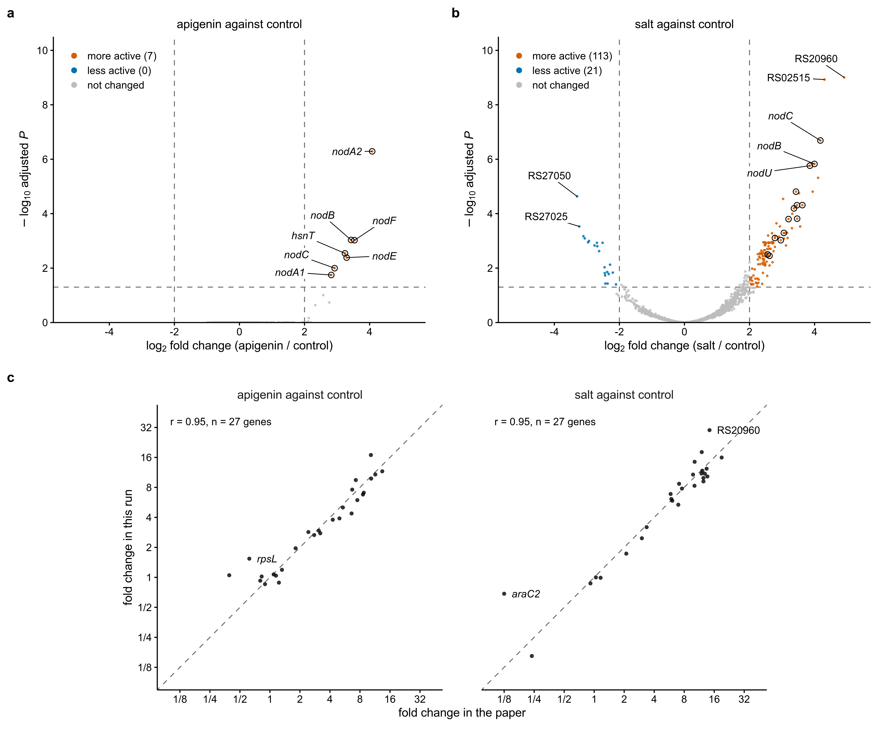

**Apigenin switches on the nodulation genes of *Rhizobium tropici*
CIAT 899, and salt switches them on as well.**

- **a** Apigenin against control. Every tested gene is a dot (6,400 genes,
  two samples per condition). Dots to the right are more active with
  apigenin; the higher a dot, the more certain the change. Coloured dots
  are the genes that changed: padj below 0.05 and at least four-fold.
  There are 7, all more active, and all are nodulation genes. Each one is
  named.
- **b** Salt against control, drawn the same way (2,430 genes tested).
  113 genes are more active (orange) and 21 less active (blue). The 14
  nodulation genes among them carry a black ring. The strongest genes on
  each side are named. A name like RS20960 is the gene's number in the
  genome annotation, RTCIAT899_RS20960, for genes that have no name:

  | Gene | What it makes | Change with salt |
  |---|---|---|
  | RS20960 | phytanoyl-CoA dioxygenase family protein | about 30 times more active |
  | RS02515 | EF-hand domain-containing protein | about 20 times more active |
  | RS27050 | helix-turn-helix transcriptional regulator | about 10 times less active |
  | RS27025 | capsular polysaccharide biosynthesis protein | about 9 times less active |

- **c** The same change measured twice: by the paper (horizontal) and by
  our run (vertical), for the 27 genes of the paper's Tables 1 to 3 that
  can be compared, once for apigenin and once for salt. A dot on the
  dashed line has the same fold change in both. The correlation is
  r = 0.95 in both plots. The three named genes are the ones that differ
  most from the paper (see "Comparison with the paper: the nodulation
  genes" above).

Good to know:

- In panel a nearly all grey dots lie flat on the bottom line. That is
  what the data look like: apart from the 7 genes, apigenin changed
  nothing that the test could confirm, so almost every other gene has a
  padj close to 1.
- Both volcano plots use the same scales, so they can be compared
  directly: salt changes many more genes than apigenin.
- The limits of this dataset apply to the figure too: two samples per
  condition, and more than 90 % ribosomal RNA (see "What to keep in mind"
  below).
- The figure is 183 mm wide, the full page width of the journal *Nature*.
  [`publication_figure.pdf`](publication_figure.pdf) stays sharp at any
  size and is the file to use for print.

To draw the figure again after a run of the analysis:

```bash
cd 03_publication_rna_seq_paired_end_rhizobium
conda activate reademption
Rscript plot_publication_figure.R
```

### Which figures and tables of the paper can be reproduced

| Paper item | What it shows | Made from | Reproduced here? |
|---|---|---|---|
| Table 1 | 20 genes measured by RNA-seq and by qRT-PCR | RNA-seq and laboratory (qRT-PCR) | **Yes**, the RNA-seq columns (in `paper_comparison_nod_genes.csv`) |
| Table 2 | Fold changes of the 22 `nod` genes | RNA-seq | **Yes**, see above |
| Table 3 | Genes behind the ten "nod boxes" | Sequence search plus RNA-seq fold changes | Partly: the fold changes of the `nod`, `y4wEF` and PB01545 genes |
| Figure 1 | Number and location of the changed genes | RNA-seq | **Yes**, as numbers: the tables in "The numbers" above |
| Figure 2 | Overlap of the apigenin and salt gene lists | RNA-seq | Partly: all 7 of our apigenin genes are also in our salt list |
| Figure 3 | Biological processes of the changed genes (Gene Ontology) | RNA-seq plus a database of gene functions | No. Needs a separate enrichment analysis. |
| Figure 4 | Circular map of the fold changes on all four replicons | RNA-seq | As numbers only, in the result tables |
| Figure 5 | Alignment of the nod box sequences | Sequence search | No. A separate sequence analysis, not RNA-seq. |
| Figure 6 | Model of the cell's response to salt | A drawing that sums up the findings | No, not a data figure |
| Additional files 4 and 5 | Fold change of every gene | RNA-seq | **Yes**, see "the whole genome" above |

### How this run differs from the paper's method

The aim of this example is to **reproduce** the paper's findings from its
public raw reads. It is not a replay of the paper's method: the paper used
a different chain of programs. The table lists every step, taken from the
paper's Materials and Methods and from [`rnaseq.sh`](../rnaseq.sh).

| Step | Paper (2016) | This run | Same? |
|---|---|---|---|
| Raw reads | Paired-end reads, deposited in a public archive | The same deposited reads, downloaded from ENA | yes |
| Aligner | "Life Technologies mapping algorithm version 1.3" | segemehl 0.3.4 (inside READemption 2.0.4), accuracy 95 % | no |
| Removal of low-quality reads | Picard Tools 1.83 | Inside READemption, quality cut-off 25; no read was changed (section 3) | no |
| Genome sequence | *R. tropici* CIAT 899, CP004015 to CP004018 | The same genome, RefSeq version (NC_020059 to NC_020062) | yes |
| Gene list (annotation) | Annotation of that time, 6,289 genes | Current NCBI annotation, 6,409 genes | no |
| Counting | htseq 0.5.4p3, only reads that fit one place | READemption `gene_quanti`; a fragment that fits several places is shared between them | no |
| Statistics | The Methods name edgeR 3.2.4; the supplementary files name DESeq2 | DESeq2 1.42.0 | unclear |
| A gene counts as changed when | at least four-fold and padj below 0.7 | at least four-fold and padj below 0.05 | no |

One more difference concerns the amount of data. The paper's
supplementary file 1 lists 54 to 211 million mapped reads per sample. The
public archive holds 10 to 29 million read pairs per sample, the numbers
in section 1. We could not find out where this difference comes from. The
archive also holds a third, small file of unpaired reads for every sample,
which this analysis does not use.

The notation `1.7e-07` means a decimal point followed by 6 zeros and then
17: the number after `e-` says how many places the decimal point moves to
the left.

## Files in this folder

| File | Content |
|---|---|
| `multiqc_report.html` | Read-quality report of section 1. Download it and open it in a web browser. |
| `read_alignment_stats.csv` | All alignment numbers per sample, counted in reads. Opens in Excel or LibreOffice (tab-separated). |
| `fragment_alignment_stats.csv` | The same numbers counted in fragments (joined pairs). |
| `deseq_comp_apigenin_vs_control_with_annotation_and_countings.csv` | One row per gene: position, description, raw fragment counts of the six samples, `log2FoldChange`, `pvalue` and `padj`. Main result table for apigenin. |
| `deseq_comp_salt_vs_control_with_annotation_and_countings.csv` | The same for salt. |
| `deseq_comp_apigenin_vs_salt_with_annotation_and_countings.csv` | The third comparison: apigenin against salt. |
| `deseq_comp_control_vs_apigenin_...`, `deseq_comp_control_vs_salt_...`, `deseq_comp_salt_vs_apigenin_...` | The same three comparisons the other way round, so every fold change has the opposite sign. |
| `paper_comparison_nod_genes.csv` | The genes of the paper's Tables 1 to 3 next to our result (section 6). |
| `rhizobium_aligned_reads.pdf` | Plot of section 2 |
| `input_reads_length_distributions.pdf`, `processed_reads_length_distributions.pdf` | Plots of section 3, one page per sample |
| `rna_class_sizes.pdf` | Plot of section 4 |
| `expression_scatter_plots.pdf` | Plots of section 5, all thirty sample pairs |
| `MA_plots.pdf` | MA plots of section 6, one page per comparison and direction |
| `volcano_plots_log2_fold_change_vs_adjusted_p-value.pdf` | Volcano plots of section 6 |
| `volcano_plots_log2_fold_change_vs_p-value.pdf` | Volcano plots with the uncorrected p-value |
| `publication_figure.pdf` | The main results as one journal-style figure (section 6), made by `plot_publication_figure.R` |
| `figures/` | The pictures shown on this page, made from the PDF files |

## What to keep in mind

- **More than 90 % of the data is ribosomal RNA.** Only 0.3 to 0.8 million
  fragments per sample measure protein-coding genes. Large changes, like
  those of the `nod` genes, are found reliably. Small changes are missed.
- There are only **two replicates** per condition, and they agree only
  roughly (section 5). Three or more would make the results more reliable.
- A gene that is not significant here is not proven unchanged. In the salt
  comparison 3,979 of 6,409 genes had too few fragments to be tested.
- The paper's genes that become more active are reproduced; most of its
  genes that become less active with salt are not, and the reason was not
  found (section 6).
- The method differs from the paper's in nearly every step (section 6,
  "How this run differs from the paper's method").
- The correlation values in the scatter plots are misleading in this
  dataset (section 5).
- The biological remarks on this page are based on the gene descriptions in
  the annotation file and on the paper.

## Reference

Pérez-Montaño F, del Cerro P, Jiménez-Guerrero I, López-Baena FJ, Cubo MT,
Hungria M, Megías M, Ollero FJ (2016). RNA-seq analysis of the *Rhizobium
tropici* CIAT 899 transcriptome shows similarities in the activation
patterns of symbiotic genes in the presence of apigenin and salt. *BMC
Genomics* 17:198.
[doi:10.1186/s12864-016-2543-3](https://doi.org/10.1186/s12864-016-2543-3)
