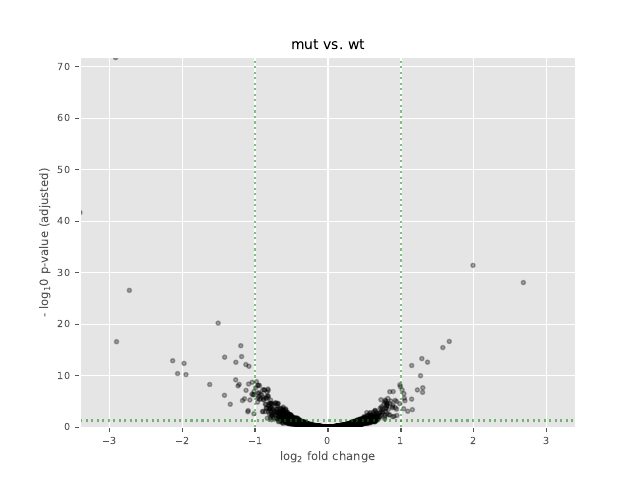

# RNA-seq analysis of bacteria and archaea with READemption

This repository shows, step by step, how to analyse RNA-seq data from
bacteria and archaea: from raw sequencing reads to a table of genes that are
switched on or off between conditions, with plots.

It uses [READemption](https://reademption.readthedocs.io), a pipeline made for
microbial RNA-seq, and follows the course material of
[AammarTufail/rnaseq_bioinformatics_ka_chilla](https://github.com/AammarTufail/rnaseq_bioinformatics_ka_chilla).

You do not need to be a programmer to rerun it. If you can open a terminal and
copy and paste a command, you can follow this page.

## Headline result

Example 02 reruns the RNA-seq analysis of a published paper
([Prasse et al. 2017](https://doi.org/10.1080/15476286.2017.1306170)) from
its public raw reads and checks the answer against the paper.



*Each dot is a gene. Dots far to the left are less active in the mutant
without sRNA154, dots far to the right more active; the higher a dot, the
more certain the change.*

- All **7 of 7** nitrogen-metabolism genes in the paper's Table 1 go down in
  our run too, with fold changes that differ by 0.07 at most.
- **52 of 62** genes in the paper's complete list (Table S1) are reproduced;
  9 are not and 1 cannot be compared.
- Published and reproduced fold changes correlate at r = 0.94.
- The paper's one RNA-seq figure (Figure 3, read coverage over six
  nitrogen genes) is redrawn from our run with an
  [R script](02_publication_rna_seq_analysis_archaea/plot_gene_coverage.R).
- The run uses current software, not the 2017 versions. Every difference
  from the paper's method is listed on the
  [results page](02_publication_rna_seq_analysis_archaea/results/README.md).

## Analyses

The analyses are added to this repository one at a time, each after it has
been run and checked.

| # | Analysis | Organism | Reads | Status |
|---|---|---|---|---|
| 01 | [READemption example data](01_example_analysis_bacteria) | *Salmonella* Typhimurium SL1344 | single-end | available |
| 02 | [sRNA154 and nitrogen fixation](02_publication_rna_seq_analysis_archaea) (Prasse et al. 2017) | *Methanosarcina mazei* Gö1 | single-end | available |
| 03 | Response to apigenin and salt (Pérez-Montaño et al. 2016) | *Rhizobium tropici* CIAT 899 | paired-end | coming next |

## What you need

- A computer running **Linux** (64-bit). On Windows, use
  [WSL](https://learn.microsoft.com/windows/wsl/install).
- An **internet connection**.
- About **5 GB** of free disk space for the software, plus space for the data
  of each analysis.
- **conda**. If you do not have it, `install.sh` tells you how to get it.

## Installation

Open a terminal and run these commands one line at a time.

**1. Download this repository**

```bash
git clone https://github.com/shabrozkhanbaloch/rnaseq_analysis.git
cd rnaseq_analysis
```

**2. Install the software**

```bash
bash install.sh
```

This takes 5 to 15 minutes. It creates two conda environments:

| Environment | What is inside |
|---|---|
| `reademption` | READemption 2.0.4, the segemehl aligner, R and DESeq2 |
| `rnaseq_qc` | FastQC, MultiQC, fastp, samtools and SRA tools |

At the end you should see a list of lines starting with `PASS`, followed by:

```
Installation complete. Every tool is working.
```

You can run `bash install.sh` again at any time. It skips what is already
installed and only repeats the tests.

## Running an analysis

Each analysis is one script. It downloads its own data, runs every step and
copies the most important tables and plots to a `results` folder.

### 01 - Salmonella example

Compares *Salmonella* grown in two conditions (InSPI2 and LSP), two
replicates each. Needs about 1 GB of disk space and about 10 minutes.

```bash
bash 01_example_analysis_bacteria/example_01_analysis.sh
```

When it ends with `Finished at: ...`, open the folder
`01_example_analysis_bacteria/results`:

| File | What it shows |
|---|---|
| `read_alignment_stats.csv` | How many reads were found on the genome, per sample. Open it in Excel or LibreOffice. |
| `deseq_comp_InSPI2_vs_LSP_with_annotation_and_countings.csv` | One row per gene: read counts, fold change (`log2FoldChange`) and significance (`padj`) |
| `volcano_plots_*.pdf`, `MA_plots.pdf` | Pictures of which genes go up or down |
| `expression_scatter_plots.pdf` | How well the replicates agree with each other |
| `rna_class_sizes.pdf` | Share of reads from protein-coding genes, tRNA and rRNA |
| `salmonella_aligned_reads.pdf`, `*_reads_length_distributions.pdf` | Alignment and read-length overviews |

**[Read the full explanation of the results and every plot](01_example_analysis_bacteria/results/README.md).**

In our run about 99 % of the one million reads per sample aligned to the
genome, and 1,055 of the 3,013 tested genes changed at least two-fold
(`padj` below 0.05): 600 higher in InSPI2 and 455 higher in LSP.

A gene is usually called differentially expressed when `padj` is below 0.05
and `log2FoldChange` is above 1 or below -1 (a two-fold change).

The scripts use all processor cores of the computer. To use fewer, for
example to keep working during a run, open the script in a text editor and
change the line `THREADS=$(nproc)` near the top to a number, for example
`THREADS=4`.

### 02 - sRNA154 in *Methanosarcina mazei*

Repeats the RNA-seq analysis of a published paper. The small RNA sRNA154
helps the archaeon *Methanosarcina mazei* to control nitrogen fixation. The
analysis compares the normal strain (`wt`, wild type) with a strain in which
sRNA154 was deleted (`mut`), two replicates each. Needs about 6 GB of disk
space and about 35 minutes.

```bash
bash 02_publication_rna_seq_analysis_archaea/rnaseq.sh
```

The `results` folder has the same kinds of files as example 01, plus
`multiqc_report.html`, a read-quality report you can open in a web browser.

**[Read the full explanation of the results and every plot](02_publication_rna_seq_analysis_archaea/results/README.md).**

In our run 88 to 90 % of the 3.8 to 6.8 million reads per sample aligned to
the genome. Of 2,771 tested genes, 53 changed at least two-fold (`padj`
below 0.05): 19 higher and 34 lower in the mutant. The genes that drop in
the mutant include glutamine synthetase and a P-II nitrogen regulator, both
part of nitrogen metabolism. All seven nitrogen-metabolism genes in the
paper's Table 1 go down in our run as well, with nearly the same fold
changes, and 52 of the 62 genes in the paper's complete list are
reproduced.

The aim is to reproduce the paper with current software, not to replay it
with the 2017 versions. The results page lists every difference between the
paper's method and this run.

Paper: Prasse et al. 2017, *RNA Biology* 14:1544-1558,
[doi:10.1080/15476286.2017.1306170](https://doi.org/10.1080/15476286.2017.1306170).
Data: NCBI BioProject PRJNA338498.

## What every analysis does

Every analysis follows the same ten steps:

1. Create the project folders
2. Download the genome and the gene annotation
3. Download the reads
4. Check the read quality
5. Align the reads to the genome
6. Calculate coverage
7. Count the reads per gene
8. Compare the conditions with DESeq2
9. Draw the plots
10. Copy the key results to `results`

Example 02 has an eleventh step: an R script plots the read coverage of
selected genes, which reproduces Figure 3 of the paper.

Every script is commented line by line. New to shell scripts? The page
[How to read the scripts](docs/how_to_read_the_scripts.md) explains the
symbols and commands they use.

## Troubleshooting

**"conda was not found"**
Install Miniforge with the two commands the message shows, close the
terminal, open a new one and run `bash install.sh` again.

**A line says `FAIL`**
Remove the environment named in the square brackets and install again:

```bash
conda env remove -n reademption -y
bash install.sh
```

**The installation stops with a download or network error**
Check your internet connection and run `bash install.sh` again. It continues
where it stopped.

**An analysis stops halfway**
Run the same command again. Files that were already downloaded are kept. To
start completely fresh, delete the `READemption_analysis` folder inside that
analysis folder first.

## Optional: Docker instead of conda

If you prefer Docker, the same tools are available as one image:

```bash
docker build -t rnaseq-reademption:2.0.4 docker/
docker/run_in_docker.sh reademption --version
```

The image builds and the tools start, but the analysis scripts have so far
only been run with the conda setup, not inside Docker.

## Repository layout

```
install.sh        installs all software
01_example_analysis_bacteria/   Salmonella example: script and results
02_publication_rna_seq_analysis_archaea/   sRNA154 paper: script and results
envs/             the two conda environment definitions
docker/           optional Docker image with the same tools
docs/             how to read the scripts (for beginners)
LICENSE           MIT licence
```

## Credits

- Pipeline: READemption, Förstner et al. 2014, *Bioinformatics*,
  [doi:10.1093/bioinformatics/btu533](https://doi.org/10.1093/bioinformatics/btu533)
- Course material: Aammar Tufail, *Bioinformatics ka Chilla*

## Licence

The code and documentation in this repository are released under the
[MIT licence](LICENSE). The sequencing data belong to the authors of the
original studies and are downloaded from public archives when a script runs.
